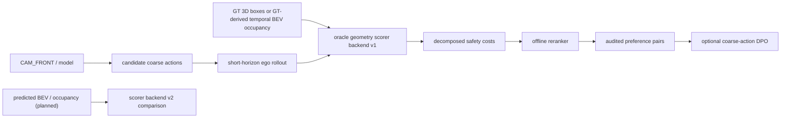

# Safety-Aware VLA for Autonomous Driving with BEV/OCC-aware Spatial Evaluation

基于 nuScenes 的安全感知自动驾驶 VLA 路线：当前以 single-camera、open-loop 的 6 类 coarse meta-action 建立可审计 MVP，长期扩展为 coarse-to-fine、共享多模态 backbone 的多任务 VLA。GT-derived BEV/OCC-aware evaluator 仍是后续离线空间评估层；项目不是完整 occupancy prediction、闭环控制或量产系统。

## Current Status

### Completed

- `CAM_FRONT`、future ego trajectory 与 nearby 3D agents 对齐和单样本 one-page visualization；
- 6 类 meta-action v0.2 derivation 与冻结；
- 108 个样本的人工审核、6 类 action 覆盖和 real-data freeze audit（108/108）；
- 现有数据检查、审核、环境检查与 workspace cleanup 脚本及对应测试。
- Phase 0.1 audited seed-subset manifest、固定 seed 的 scene-level split、Majority Baseline、六类统一评测协议、invalid prediction 指标处理和完整 manifest contract validator。
- Phase 0.1b trainval dataset protocol v1、完整 850-scene manifest、official-train scene-level label-stratified split、排除原因诊断与 train/validation 视觉审核。

### Planned

- coarse action 的 rule-based、zero-shot / few-shot 与 LoRA / action adapter baselines；
- GT-derived BEV/OCC-aware temporal safety evaluator、offline reranker 与可选 coarse-action DPO；
- short temporal input、map / route、fine-grained maneuver、continuous waypoint、optional BEV/OCC auxiliary 与闭环或 quasi-closed-loop evaluation。

Phase -1 freeze gate 与 Phase 0.1 均已完成并合并；Phase 0.1b dataset protocol v1 已完成全量构建、自动验收、排除原因诊断和 train/validation 视觉审核并冻结。当前已实现 coarse meta-action label/data protocol、audited/trainval manifest infrastructure 与 Majority Baseline；coarse neural action head、Qwen3-VL、rule-based baseline、LoRA、action adapter、安全 scorer、reranker、DPO、fine maneuver、waypoint 与 predicted BEV/OCC 均为 planned。

## Inference and Safety Boundaries

Inference inputs 仅为 `CAM_FRONT` image、driving instruction 与 current `ego_state`（当前速度、加速度、yaw rate 等）；future ego trajectory、GT meta-action、GT BEV/OCC raster 与未来 GT agents 不进入模型推理。

GT meta-action 与 GT future trajectory 是训练 target；current/future GT agent boxes、ego pose 与 optional map 仅进入 oracle offline evaluator。GT boxes、future GT agents 与 GT occupancy 均不得进入模型 test-time inference。collision check 比较 candidate ego rollout 或 predicted trajectory 与 scorer backend，不能以 GT ego trajectory 代替预测候选行为。



完整信息合同、temporal `occupancy[T,C,H,W]`、阶段 gate 和 loss 边界见 [project_mvp_plan.md](project_mvp_plan.md)。

## Why Coarse Meta-Action

当前固定 coarse schema：`keep`、`accelerate`、`decelerate`、`stop`、`left_lateral`、`right_lateral`。它将连续轨迹转为可学习、可人工审核的行为语义，作为当前 MVP 的 coarse target、可解释输出、辅助监督和长期 baseline，而不是最终固定动作空间。

`left_lateral` / `right_lateral` 仅表示未来轨迹中稳定的左右横向运动；当前版本不区分 lane change、turn、follow-road-curve 或横向运动原因，因此不得解释为左/右变道或左/右转。只有接入 map、lane topology、intersection topology、route command 或 short temporal context 的至少一部分后，才会新增并重新审核 fine-grained maneuver labels。

长期模型采用共享多模态 backbone 加多任务 head：coarse meta-action、longitudinal action、lateral direction、maneuver type、continuous waypoint，以及 optional BEV / occupancy auxiliary。当前已实现的是 coarse label/data protocol；coarse neural action head、LoRA 和 action adapter 仍是 planned，其他 head 也均为 planned。真实驾驶行为可组合（如左转+减速），因此长期路线采用层级/多头表示，不把 6 类直接硬改成更多互斥类别。

## Current Phase 0.1 Manifest Schema

当前 `phase0_audited_seed_subset_v1` 仍是 audited seed-subset schema，不是完整 trainval 训练数据。Phase 0.1b 已冻结正式 `phase0_trainval_dataset_manifest_v1`：在相同稳定字段基础上增加 `official_split`、`split_seed`、`split_strategy_version`、`split_mapping_sha256`、`audit_status` 与 `source_audit_record` 追溯；已有 audit token 保留完整审核来源，未匹配记录保持 `unaudited/null`。当前 `label_rule_version=phase-1.6-meta-action-v0.2`，旧 schema 保持兼容。

`current_ego_pose` 记录 `frame`、`translation_m`、`rotation_wxyz`、`timestamp_us`、`timestamp_source`；`current_ego_motion` 记录 `speed_mps`、`longitudinal_acceleration_mps2`、`yaw_rate_radps`、`source`、`timestamp_source`、`availability`、`history_interval_sec`、`acceleration_interval_sec` 与 `unavailable_reason`。timestamp source 固定为 `CAM_FRONT_sample_data`，motion 仅使用当前和历史 pose，绝不使用 future pose 或 future trajectory。正式 trainval dataset manifest v1 位于 `$VLA_DERIVED_ROOT/phase_0_1b/trainval_manifest_v1/`，不进入 Git，且不得由后续实验静默覆盖。

## Quickstart: Existing Commands

以下均为当前仓库已有命令；验证时使用 `codex4vla_env`：

```bash
conda run -n codex4vla_env python scripts/check_env.py
conda run -n codex4vla_env pytest tests/test_check_env.py tests/test_clean_workspace.py tests/test_inspect_nuscenes_sample.py tests/test_verify_labels.py tests/test_meta_action.py tests/test_phase_1_7_manual_audit.py
conda run -n codex4vla_env python data/validate_label_freeze.py --dataroot data/nuscenes
conda run -n codex4vla_env python scripts/clean_workspace.py
conda run -n codex4vla_env python data/build_trainval_manifest.py --config configs/trainval_manifest.yaml --pilot
```

trainval pilot 命令要求预先设置 `NUSCENES_ROOT` 与 `VLA_DERIVED_ROOT`；派生 manifest 写入后者且不进入 Git。`clean_workspace.py` 默认仅输出 dry-run 候选，不删除文件。项目当前不提供 neural baseline、reranker、DPO 或 trajectory training 命令，因为它们尚未实现。

## Phase 0.1b Dataset Protocol v1（Frozen）

正式 split 先基于完整官方 train/val scenes 固定：官方 train 的 700 scenes 使用 seed `20260710` 和 `official_train_scene_label_stratified_v1`，按有效样本六维 action histogram 映射为 project train 560 / validation 140；官方 val 的 150 scenes 不参与优化并全部作为 project test。目标函数为 train/validation 相对 official train 的类别分布距离、validation scene coverage 偏差与长尾硬约束罚项之和；实测 stratified objective 为 `0.0020518908`，fixed-random 对照为 `0.0605638706`，六类硬约束均满足。pilot 再以 seed `20260715` 从该固定映射中选择 20 scenes，实际覆盖 train 13 / validation 3 / test 4。

正式协议冻结为 `horizon_sec=3.0`、`sample_interval_sec=0.5`、`time_tolerance_sec=0.075`、`label_rule_version=phase-1.6-meta-action-v0.2`、`split_strategy_version=official_train_scene_label_stratified_v1`、`split_seed=20260710`。全量扫描 34,149 samples，纳入 21,646 条（train 14,253 / validation 3,594 / test 3,799），排除 12,503 条：`insufficient_remaining_horizon=5210`、`timestamp_out_of_tolerance=7293`。两类排除均已完成专项诊断；未发现时间单位、timestamp source、nearest-search、scene-chain 或浮点边界实现错误。

正式 manifest 文件 SHA-256 为 `60517f985fec8fe3977a31660a5204942e9fd36baf09ea4d950328b1f225d1b3`，scene mapping sidecar 文件 SHA-256 为 `fa94cc4c1d7b7b24476d6043cd132fa0b7fa5ace2285a82200c363a3d3501be8`，内部 mapping SHA-256 为 `a96e04aaf068e75b0aa3ecb8412dc5b35fea2412d7090bbee0a6661132923b12`，scene histogram SHA-256 为 `0cee51a6f64e3f2e10382ca7672cc0aa1386065a3fe8a1f927f5469e211a11a2`。108 个历史 audit token 全部匹配，manifest 为 `audited=108`、`unaudited=21538`；duplicate token、scene overlap、绝对路径泄漏、缺失 CAM_FRONT 和 official/project split 违规均为 0，rare-class constraints 与 full manifest validation 均通过。

train/validation 视觉审核未发现明显轨迹方向、左右坐标或时间顺序错误，test 未用于协议选择并继续封存。0.100 秒 nearest candidate 可恢复更多样本，exact-grid interpolation 的总体标签一致率为 98.0458%，但 validation `decelerate` 一致率为 91.89%，仍存在边界风险，因此正式协议保持 0.075 秒；exact-grid interpolation 仅作为可选 v1.1 数据增强 backlog，不阻塞后续阶段。

## Repository Entry Points

- [project_mvp_plan.md](project_mvp_plan.md)：阶段输入/输出、gate、评测表、风险与信息边界；
- [docs/progress.md](docs/progress.md)：已确认的事实、稳定 CLI、字段约定与 pending items；
- [AGENTS.md](AGENTS.md)：任务边界、固定 schema、阶段顺序和禁止事项；
- `data/inspect_nuscenes_sample.py`、`data/derive_meta_action.py`、`data/verify_labels.py`：当前数据闭环入口。

## Roadmap and Scope

当前顺序为：Phase -1 数据闭环与 coarse 标签冻结（completed）→ Phase 0.1 manifest 协议、scene-level split、统一 metrics 与 Majority Baseline（completed）→ Phase 0.1b trainval scale-up 与 dataset protocol v1 冻结（completed）→ Phase 0.2 ego-motion rule baseline（next）→ Phase 0.3 Qwen3-VL zero-shot / few-shot → Phase 0.4 coarse LoRA / action adapter → Phase 0.5a geometric safety scorer → Phase 0.5b offline safety reranker → Phase 0.6 preference pair audit 与可选 coarse-action DPO。mini 只用于数据链路 smoke test、快速回归、人工审核和小规模调试；正式 LoRA、action adapter 与 DPO 必须基于 trainval manifest，mini 上仅允许 smoke run。

后续扩展为：short temporal input → map / route / lane topology → hierarchical fine-grained maneuver → continuous waypoint head → BEV / occupancy auxiliary supervision → closed-loop or quasi-closed-loop evaluation。Phase 0 的 action experiments 仍须报告 macro-F1、per-class F1、confusion matrix、class distribution、invalid output rate 与 failure cases；safety 结果同时监控 collision/near-miss、VRU、`unnecessary_stop` 与 macro-F1。

DPO 是第一版 MVP 的可选终点，而不是整个项目的最终终点：scorer gate 未通过不进入 reranker；reranker 未证明风险改善且不过度增加 `stop` 时不构造 DPO pairs；只有 preference pair audit 通过后才进入可选 DPO。若 DPO 不优于 reranker，保留 reranker 作为 MVP 结果。若动作空间扩展为 fine maneuver 或 continuous waypoint，preference pairs 需要重建；coarse checkpoint 可作为初始化或对照，旧分类 head 不保证直接适用于新 target。

BEV / occupancy 是场景空间表示，不直接等于安全决策，也不替代 candidate rollout 与 geometric scorer。Scorer backend v1 使用 nuScenes GT 3D boxes 或由 GT annotation 构造的 ego-centric temporal BEV occupancy，作为验证几何规则合理性的 oracle offline evaluator；它不代表 camera-only occupancy prediction。Scorer backend v2 的 predicted BEV / occupancy 仅为 planned，用于评估感知误差下 scorer 是否仍有效。当前不声称 CARLA、实车、real-time、闭环驾驶、trajectory-level 结果或 occupancy prediction 能力。

## Honest Portfolio Statement

当前可写：基于 nuScenes 完成 `CAM_FRONT`、future ego trajectory 与 nearby 3D agents 对齐，派生 6 类可审计 meta-action，并完成 108 样本人工审核。BEV/OCC-aware safety evaluator、reranker、DPO、trajectory head 与 occupancy prediction 均为 planned，直至有真实代码、配置和可核查结果。

## Stage 2C：Two-Turn Inference Benchmark

Stage 2B 新启动进程的 Monitor / Full Validation 默认使用 batch 1，可用 `--inference-batch-size 1|2|4` 设置；该参数独立于训练配置，原训练 checkpoint / optimizer / RNG resume 合同保持不变。SFT validation 默认跳过概率 forward，概率字段保存为 `null` / `not_computed`；Stage 2A 默认继续计算真实 log-probability，`assistant_log_probs` 保持可微接口。

批量生成使用左侧文本 padding，视觉 patches 与 grids 按样本/图像顺序拼接；第一轮提前结束后的 padding 不属于生成 token，第二轮仅处理有效且含 EOS 的动作，并保留原始动作 IDs。图像每条样本预处理一次，第二轮使用同一视觉输入及文本模板 suffix；Qwen3-VL 自行计算多模态位置编码。两轮各自显式启用 Transformers KV cache，**跨轮 KV cache 复用未实现**：不同动作长度、EOS 后 padding、有效子批次与 Qwen 的 `rope_deltas` / cache position 需要进一步独立验证，本阶段保留标准 prefill。

以下保留已执行实验的复现入口，当前收尾不再安排 GPU 执行；本地已验证 CLI 和 CPU 接口，首次真实 4B BF16 GPU 结果及当前分项验收状态见下文。先将 `STAGE2B_CHECKPOINT` 设置为已完成的 SFT checkpoint 目录（其中包含 `adapter/`），保留现有 `NUSCENES_ROOT`、`VLA_DERIVED_ROOT` 和模型缓存；Full SFT 已由用户确认完成，在独立 checkout / 新进程运行：

```bash
conda run --no-capture-output -n codex4vla_env python scripts/benchmark_drivema_stage2c.py \
  --checkpoint "${STAGE2B_CHECKPOINT:?Set an existing completed Stage 2B checkpoint directory}" \
  --config configs/drivema_stage2b_full.yaml \
  --dataset-root "$NUSCENES_ROOT" --derived-root "$VLA_DERIVED_ROOT" \
  --batch-size 4 --samples 64 --warmup-samples 4 \
  --output "$VLA_DERIVED_ROOT/drivema/stage2c_benchmark_run01"
```

一次任务固定按 sample token 排序的前 64 条 validation，使用同一个模型实例 / checkpoint、BF16、SDPA 与原 greedy 参数，分别 warmup 后对比原串行含概率 forward 与批量跳过概率 forward。完整时间包含图像读取、预处理、两轮生成、可选概率和评测，排除模型/数据 intake、warmup 和产物写盘；分轮计时仅在边界同步 CUDA。P50/P95 为样本所在 batch 的完成延迟，不除以 batch size；总耗时减少比例与吞吐加速比另列。显存为 measured track 内 peak allocated（含模型）。每 16 条输出进度、elapsed、samples/s 和 ETA。

输出目录必须尚不存在，包含 `metadata.json`、两条路径的 `*_predictions.jsonl` / `*_metrics.json`、`benchmark.json` 和 `summary.md`；均留在 derived root。JSON 保存分轮耗时、实际生成 token 数、完整 action metrics 及逐样本 token/span/文本/指标一致性检查。任何差异使退出码为 1，保留两侧产物供定位；严格一致性失败保持 FAIL；离线吞吐、质量与结构覆盖分别报告，不能将吞吐收益称为严格等价加速。没有额外 GPU 消融或 Full Validation。

后续 Turn-Level GRPO 可复用 observation 列表批量入口、每条原始 token/span 和显式可选的真实概率重算；group sampling、共享前缀 cache 管理及 GRPO loss 均未实现。

## Stage 3A：Verifiable Reward 与四候选 Rollout

Stage 3A 的开发分支依赖 [Stage 2C main 集成 PR #60](https://github.com/TNAG031231/4vla_learning/pull/60)，两者均待审阅合并；Stage 3A 固定读取 `$VLA_DERIVED_ROOT/drivema/stage2b_full_run01/checkpoint_3564/adapter`，只生成 train 候选并计算 reward/advantage，optimizer updates 为 0。

`configs/drivema_stage3a.yaml` 默认选择按 sample token 排序的前 4 个合格 train observations，每个生成 G=4 个候选，micro-batch=1；保留部分有效动作标签，排除两轴都无监督或无有效轨迹点的样本。输入复用历史 CAM_FRONT/ego state，GT 只在生成完成后的 reward 计算使用。SFT 的 joint-valid eligibility 和 validation evaluator 保持原定义。

- Action reward：有效 GT 维度上的正确率，两轴有效时各占 0.5；无效/未结束动作得 0。
- Trajectory reward：`exp(-(0.7*ADE@3s + 0.3*FDE@3s)/1m)`，复用原 evaluator 和 mask；3 秒终点缺失时记录 `masked_ADE_only_missing_3s_endpoint`，只用有效点 ADE。冻结 temporal v0.1 intake 仍要求六点有效，缺终点规则在 reward 单元测试中验证。
- Consistency reward：复用 `trajectory_to_meta_action` 和冻结阈值，与第一轮动作逐轴比较并平均；无效轨迹得 0。
- `r1=R_action`，`r2=R_traj+0.5*R_cons`；每轮独立按四个候选计算 `(r-mean)/(std+1e-4)`，`std` 使用 sample standard deviation（correction=1），完全零方差时 advantage=0。无效和缺失候选的零奖励保留在四候选统计中，不重采样。

两轮均使用 categorical sampling：`do_sample=True, temperature=1, top_p=1, top_k=0`。显式 `use_model_defaults=False` 禁止 Transformers 将模型默认 repetition penalty 等注入采样；保存完整 GenerationConfig。CPU 测试核对实际 logits processor/warper 列表为空，并比较生成 scores 提取的 old log-prob 与相同 token 的 teacher-forced raw log-prob。第二轮 prefix 保留当前候选第一轮实际 IDs，EOS/长度截断单独记录。

已执行的本地检查：

```bash
conda run -n codex4vla_env python scripts/run_drivema_stage3a.py --help
conda run -n codex4vla_env python scripts/run_drivema_stage3a.py --dry-run
```

真实 GPU rollout 由用户执行（本机未运行）：从 clean checkout 设置已有 `NUSCENES_ROOT`、`VLA_DERIVED_ROOT`，使用上述入口去掉 `--dry-run`；默认参数在 YAML 中，`--config` 可指定配置副本和新的 output_relative_dir。已有输出目录拒绝覆盖，原 SFT checkpoint 只读。

输出位于配置指定的 derived 目录：`metadata.json`（checkpoint/版本/seed/实际 generation config）、`groups.jsonl`、`summary.json`、`example.md`。每组保存 Observation 与四个 candidate；每个 candidate 保存 sample token、candidate index、完整 input IDs、各轮 prefix IDs、assistant `[start,end)`、实际生成 IDs、EOS、parser status、waypoints、reward、advantage 和 turn mask。缺失第二轮没有 span/假 token；已生成但无效或达到长度上限的 tokens 保留，用低奖励学习。

Stage 3B 接口：`replay_inputs` 以原 Observation 重建视觉输入并恢复完整 IDs；`assistant_log_probs` 可分别对 current/reference 模型重算同一组 span；`policy_targets` 返回对应 old log-probs、目标位置、`t-1` logits 位置、逐 token turn ID/advantage/loss mask。只包含真实生成 tokens，prompt/图像/user suffix 不进入 loss；old probabilities 和 advantage 已 detach。Stage 3B 重算时应保持 eval 模式关闭 dropout，同时为 current policy 保留梯度，冻结 old/reference；当前阶段没有 GRPO loss、KL 或 optimizer loop。

四候选可读示例（**受控 synthetic 测试，非真实 4B 随机采样结果**）：观测为一帧合成 CAM_FRONT 与 unavailable ego state，GT action 为 keep/straight，GT 轨迹 `P=[(1,0),…,(6,0)]`，停止轨迹 `Z=[(0,0)]×6`。

| 候选 | 预测动作 | 预测轨迹 | R_action / R_traj / R_cons | A1 / A2 | Turn mask |
| --- | --- | --- | --- | --- | --- |
| 0 | keep / straight | P | 1 / 1 / 1 | 1.224445 / 0.996376 | true / true |
| 1 | stop / straight | Z | 0.5 / 0.014264 / 1 | 0 / -0.439674 | true / true |
| 2 | keep / left | P | 0.5 / 1 / 0.5 | 0 / 0.632168 | true / true |
| 3 | invalid | 缺失 | 0 / 0 / 0 | -1.224445 / -1.188870 | true / false |

最后一行的 A2 参与统计记录，但没有第二轮训练 token。随机 Tiny-Qwen 的真实候选按原样记录 invalid；不会用上表示例替换随机输出。

参考 [DriveMA 官方 per-turn reward / advantage 实现](https://github.com/Tsinghua-MARS-Lab/DriveMA/blob/de20e6c64878bc3413d26d69362c3be9b3a91533/swift/rlhf_trainers/grpo_trainer.py)：分别构造两轮标量奖励、按组归一化，再映射到该轮 token。本项目采用本次指定的 3 秒六点、三项 reward 权重和 LoRA 初始化，不迁移官方额外 reward 或训练框架。

RTX 4080 上的下一步是 Stage 3B：实现逐 token clipped ratio objective 与 reference KL；冻结行为策略概率和 SFT reference、只更新 current LoRA，按 observation/group 组织 accumulation 与 mask；先测无更新时 ratio≈1 和有限梯度，再验证少量更新、保存重载、峰值显存与 GPU smoke。G=4 micro-batch=1 控制 rollout 峰值，reference 顺序计算/CPU offload 或 adapter 切换的显存方案仍需真实测量；本阶段没有 4080 训练显存结论。

## Data

nuScenes 数据受其原始许可约束，不随本仓库分发；原始/派生数据、模型权重、日志、缓存和 secrets 不进入 Git。

### Stage 2C 小样本差异诊断

用户报告首次 64 样本 GPU 验收失败（48 个 Turn 2 generation mismatch、15 match、1 prefix mismatch）；严格一致性未通过，离线吞吐收益及代价见最终结论。已提供的 prefix 样本 `03894f5a6a294cc6876d2fe3fa9229e7` 在 Turn 1 已从 baseline `decelerate` 变为 optimized `keep`，前缀差异不能据此归因于 suffix。CPU 上 12 种动作 × 1/3 帧历史的串行/批量完整 token 对照一致；四样本结构检查和五处保存的 raw-logits 选择审计已由用户确认通过；批量数值差异是合理解释，尚不能将 BF16 认定为唯一原因。

以下为已完成诊断的复现入口，本次收尾不再执行：先离线分析原有两个 JSONL，再仅对该失败样本所在的原 batch 四条样本依次运行 Serial、Optimized Batch 1、Optimized Batch 4（各一次、无训练）；保留原同伴及顺序，不运行 64 条生成。使用原 metadata 记录的 checkpoint / 生成设置和现有缓存，输出目录须全新：

```bash
conda run --no-capture-output -n codex4vla_env python scripts/diagnose_drivema_stage2c.py \
  --benchmark-dir "$VLA_DERIVED_ROOT/drivema/stage2c_benchmark_run01" \
  --sample-token 03894f5a6a294cc6876d2fe3fa9229e7 --gpu \
  --dataset-root "$NUSCENES_ROOT" --derived-root "$VLA_DERIVED_ROOT" \
  --output "$VLA_DERIVED_ROOT/drivema/stage2c_diagnostic_run01"
```

去掉 `--gpu` 可仅分析已有预测，不加载模型或数据。`saved_analysis.json` 区分 Turn 1 动作变化、suffix/prefix 变化及相同前缀下的 Turn 2 生成变化；`diagnosis.json` 检查 Serial 复现、Batch 1/4 严格输出/指标一致性，并逐样本比较原始 pixels/grid、有效 attention mask、实际 position IDs、归一化 padding 后的 cache position / rope_deltas 和 generation 配置。首处分歧保存原始全词表 logits 与位置张量到 `*_first_difference.pt`，JSON 报告 argmax、top-2 margin、最大 logit 差值；仅在输入、位置及此前生成 token 一致时才可讨论数值原因。诊断 hook 会复制 CPU 张量，耗时不用于性能结论。

小样本严格检查失败仍退出 1，失败记录保留；Batch 1 + 跳过概率 forward 是已报告通过精确对照的回退路径。当前已有四样本诊断与 64 样本 GPU 结果，按下节分别审阅结构、数值一致性、质量和性能，不重复运行完整 Benchmark；未修改生产推理、SFT 训练或跨轮 cache。

### Stage 2C 分项验收与离线 logits 审计

2026-11-11 用户报告：Serial vs Saved / Batch 1 通过，Batch 4 严格一致性失败；可比上下文的输入/位置/cache 对照通过，64 条样本吞吐量提升 2.13×、ADE/FDE 无退化、两侧 invalid 均为 0。这些为用户提供的 GPU 结果，本机未独立读取原始产物。严格失败继续保留；结构、数值一致性、质量、性能分别记录，不再将它们混为一个 gate。

已复现并修正诊断 `top2()` 将 `topk.indices[0]` 当作 argmax 的错误：并列最大值时 top-k 排序可与 greedy 使用的 `torch.argmax` 不同，例如 450/13096 并列时，旧报告可写成 13096，而真正 argmax 为 450。该修复只影响诊断报告。实际采样使用 processed scores；新增诊断采集会记录每步 processed argmax 与生成 token，CPU real-greedy 对齐测试通过。以下保留已完成的离线审计复现入口，当前收尾不再安排重复运行：

```bash
conda run --no-capture-output -n codex4vla_env python scripts/report_drivema_stage2c.py \
  --benchmark-dir "$VLA_DERIVED_ROOT/drivema/stage2c_benchmark_run01" \
  --diagnostic-dir "$VLA_DERIVED_ROOT/drivema/stage2c_diagnostic_run01" \
  --output "$VLA_DERIVED_ROOT/drivema/stage2c_acceptance_run01"
```

新目录输出 `acceptance.json` / `summary.md`，保留原 `strict_consistency_original`，统计完整生成序列一致率与每轮逐位置 token 一致率（含 EOS，缺失计错），列出完整 Action 指标、ADE/FDE/invalid、总时间/吞吐/P50/P95/峰值显存，并修正已保存分歧处的 raw argmax。轨迹质量 gate 独立定义为同一批样本 ADE@3s、FDE@3s、invalid rate 均不高于 baseline，属于本次明确新增的描述性标准，不是对原严格 gate 的追溯替换；Action 质量单列，不擅自添加容忍阈值。报告程序退出 0 仅表示报告生成完成，不表示验收通过。

用户已确认保存的五处分歧 raw-logits 选择审计通过，旧 argmax 矛盾已由诊断 tie-order 错误解释；这不证明所有 logits processor 均关闭，只说明这些位置的最终选择对齐。可比上下文、位置和生成协议对齐后，微小 logit 差异与小 margin 支持批量数值扰动解释，不声称排除了全部硬件/内核因素。技术结果和学习总结见 PR #59，正式 merge 后评论按仓库流程发布；Stage 3 尚未启动。

### Stage 2C 最终定位与默认入口

Stage 2C 定位为**离线吞吐优化**：生产入口默认 `--inference-batch-size 1` 并跳过冗余概率 forward，Batch 2/4 需显式指定。Batch 1 的精确对照证据覆盖原四样本诊断，不扩展声称全部数据严格等价；Batch 4 是接受已知预测差异的离线吞吐选项，不能替代默认路径并宣称严格等价。

用户确认的同批 64 条 validation：Batch 4 吞吐提升 **2.1346×**、总耗时减少 **53.15%**；ADE@3s **0.8213 → 0.8122 m**，FDE@3s **1.7685 → 1.7484 m**，invalid rate 两侧均 **0**。Longitudinal macro-F1 略降，joint accuracy 下降 **1/64（1.5625 个百分点）**，lateral macro-F1 不变；P50/P95 样本所在 batch 的完成延迟上升，GPU peak allocated memory 增加。严格一致性仍为 **FAIL**，序列一致率 **23.44%**、逐位置 token 一致率 **89.88%**。这些是用户确认的实验数据，本机未重新运行或读取远端原始产物；用户于 2026-11-12 补齐的完整精确表已记录在 [docs/progress.md](docs/progress.md)，原产物保留在 `stage2c_acceptance_run01/acceptance.json` / `summary.md`。总时间为 **586.4829 → 274.7469 s**，P50 **9.2699 → 17.1934 s**，P95 **10.2255 → 18.4011 s**，峰值 allocated 显存 **10,239,534,080 → 14,546,409,984 bytes**；精确吞吐比 **2.134630008095207×**。

结构审计只覆盖四条代表样本的可比上下文，raw-logits 选择审计只覆盖保存的五处分歧；这些证据支持批量计算数值扰动解释，不证明 BF16 是唯一原因，也不构成全量正确性证明。仅可声称同批 validation 上的离线吞吐收益与所述质量取舍，不宣称实车低延迟、实时/闭环部署、跨轮 KV cache 复用或严格预测等价。原 gate、历史产物及训练协议均不变，不追加 GPU 实验；Stage 3 Turn-Level GRPO 将单独建 PR。
