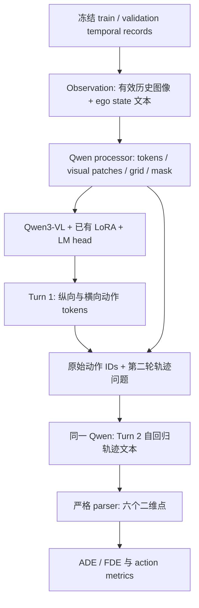

# Stage 2B 学习总结：从语义动作到 Two-Turn 轨迹 SFT

> **面试时可以先这样回答：** 我把原来“动作 LoRA + 独立连续轨迹 Decoder”的链路，扩展为 Qwen3-VL 原生两轮生成：先根据历史图像和 ego state 输出纵向/横向动作，再根据同一观测与生成动作输出六个 waypoint。训练同时监督两轮 assistant tokens，只更新已有 LoRA；这样动作与轨迹都有可计算的 token likelihood，为后续 turn-level policy optimization 提供接口。真实 Full SFT 在 3594 条 validation 上得到 ADE/FDE@3s 0.750680/1.641694 m，相比历史最强 Ego-History MLP 分别下降约 7.84%/7.38%。

本文依据 [PR #58](https://github.com/TNAG031231/4vla_learning/pull/58) 的实现、现有历史实验记录和用户于 2026-11-12 提供的 AutoDL Full 结果；GPU 实验由用户执行，本次 Codex 只审阅代码并运行 CPU 回归。已有项目学习笔记采用“技术问题 → 实现 → 实验 → 面试解释”的组织方式，本篇沿用该方式。

## 1. 为什么改变轨迹输出方式？

三个阶段保留了历史/当前 CAM_FRONT 与 ego state 输入，主要变化发生在**预测对象、可训练参数和 loss**：

| 路线 | 输出与结构 | 训练方式 | 可复用的能力 |
| --- | --- | --- | --- |
| Meta-Action SFT（Phase 0.4b） | Qwen LM head 输出 `longitudinal=…; lateral=…` | 冻结 base，LoRA 学习动作 token CE | 语义决策与动作 adapter |
| Action-conditioned WaypointDecoder（Phase 0.4c） | 动作上下文进入 Qwen，独立 learned queries / cross-attention decoder 输出 `[6,2]` 连续坐标 | Qwen/LoRA 冻结，只训练 decoder；masked SmoothL1 | 连续几何回归与动作条件分析 |
| Two-Turn SFT（Stage 2B） | 同一 Qwen LM head 先输出动作文本，再输出六个坐标对文本 | 复用动作 adapter，联合监督两轮 token CE，仅更新 LoRA | 动作和轨迹统一的自回归概率接口 |

历史 predicted-action WaypointDecoder Epoch 2 的 ADE/FDE 为 0.992346/2.035392 m，GT-action 诊断为 0.810181/1.541940 m，提示动作预测质量会影响轨迹；这解释了为什么需要同时关注语义和规划。转向 Two-Turn 的另一关键理由是：连续 decoder 输出坐标，没有现成的离散 trajectory sequence likelihood；文本化轨迹可复用 LM 的 token log-probability，为后续 GRPO 提供优化对象。

这里把坐标保留两位小数后交给**原生 tokenizer**，没有新增轨迹 codebook 或专用 action vocabulary。它带来统一接口，也引入格式生成成本；token CE 优化正确文本的概率，坐标数字的 token 错误与米制位移误差并不一一对应，因此模型选择必须看生成后的 ADE/FDE。

## 2. 完整数据流：观测怎样变成六个点？



`phase0_4b_protocol.adapt_record` 按从旧到新的顺序读取历史槽位，最多三帧；每个有效槽位包含相对当前时刻的时间、图像与 ego-motion 文本，缺失历史由 mask 表示，不补造图像。速度、加速度、yaw rate 等状态按既有字段顺序和精度序列化，缺失数值使用已有 unavailable 表达。Ego state 在本路线中进入文本 token，而不是额外的数值 MLP。

`inference_messages` 将每帧文本与图像交错放入 user message。processor 产生 `input_ids`、`attention_mask`、`pixel_values` 和 `image_grid_thw`，Qwen 的视觉编码与语言模型处理这组多模态观测。训练 target 与 Observation 分开；预测函数只接收 Observation，不接收 future waypoints。

Turn 1 输出示意为 `longitudinal=keep; lateral=straight`，合法值沿用冻结的纵向四类、横向三类；left/right 表示横向运动。Turn 2 在同一观测之后接入第一轮 assistant response 和固定轨迹问题，生成六个 `[x, y]`：时刻为 0.5、1.0、1.5、2.0、2.5、3.0 秒，坐标为当前 CAM_FRONT 时间的 ego frame，x 向前、y 向左，单位米。

推理保留**模型实际生成的第一轮 token IDs**，只补接下一轮模板后缀，避免 decode/re-encode 改变 conditioning。动作解析合法且以 EOS 结束才进入第二轮；轨迹必须以 EOS 结束并满足严格六点格式，否则保留 invalid 原因。当前使用 greedy generation。

## 3. Teacher Forcing、assistant span 与梯度

### 3.1 一次训练 forward 中有什么？

训练对话是：

```text
User: 历史/当前图像 + ego state + 动作问题
Assistant: GT meta-action + EOS
User: 基于上述动作预测六个 waypoint
Assistant: GT trajectory text + EOS
```

Teacher forcing 表示预测每个目标 token 时，前缀中提供正确的先前 token。因此训练第二轮以 GT action 为条件，验证第二轮以模型生成的 action 为条件；训练没有先 greedy 生成动作再对离散生成结果反传。完整对话可在一次 causal forward 中计算所有监督位置，因果 attention 保证某个 token 看不到后面的答案。

`encode_teacher_forcing` 使用真实 processor 的 prefix 编码核对两轮 assistant 的 `[start,end)` 区间，内容与 EOS 参与监督，user/image/role header/分隔换行的 labels 为 `-100`。这些 span 是监督位置的准确索引；输入 token 虽不直接计算 CE，仍作为上下文影响输出。

### 3.2 Token log-probability 是怎样算的？

设完整 token 序列为 \(z_0,\ldots,z_{T-1}\)，位置 \(t\) 的目标 token 为 \(z_t\)，词表大小为 \(V\)。因果 LM 在位置 \(t-1\) 的 logits \(h_{t-1,v}\) 预测它：

\[
\ell_t=\log p_\theta(z_t\mid z_{<t},I)
=h_{t-1,z_t}-\log\sum_{v=1}^{V}\exp(h_{t-1,v}).
\]

\(I\) 表示输入图像，\(\theta\) 表示模型参数。`assistant_log_probs` 通过 `positions - 1` 实现 causal shift，取目标 token 的 logit 并减去 `logsumexp`；返回 tensor 保留 autograd。保存到 JSON 的概率只是数值记录，后续 policy loss 需要用当前模型重算可微 log-prob。这里计算原始策略概率，不做 temperature/top-p 变换。

### 3.3 两轮 CE 如何组合？

设样本 \(i\) 的两轮 span 为 \(S_{i,1},S_{i,2}\)，token 数为 \(n_{i,1},n_{i,2}\)，均含 EOS。每轮平均 CE 与实际样本 loss 为：

\[
L_{i,k}=-\frac{1}{n_{i,k}}\sum_{t\in S_{i,k}}\ell_{i,t},\qquad
L_i=\frac{n_{i,1}L_{i,1}+n_{i,2}L_{i,2}}{n_{i,1}+n_{i,2}}.
\]

两轮的**每个 token 权重相同**；轨迹通常更长，因此它对样本 loss 的贡献通常更大，实际目标不是 \((L_{i,1}+L_{i,2})/2\)。日志的 `action_ce`、`trajectory_ce` 分别按各轮 token 数聚合，便于观察语义与坐标学习；优化 loss 先按样本内 token 平均，再按当前 accumulation group 的样本数 \(B\) 平均：

\[
L_{\mathrm{group}}=\frac{1}{B}\sum_{i=1}^{B}L_i.
\]

Full 的 micro batch 为 1，accumulation 为 4，通常四个样本 backward 后执行一次 AdamW；末组只有一个样本，代码按实际 group size 归一化。因此 \(\lceil14253/4\rceil=3564\) optimizer steps，不会将最后一个样本梯度额外缩小为四分之一。

### 3.4 LoRA 更新什么？

已有 attention projection 的 LoRA 可写为 \(W=W_0+(\alpha/r)BA\)，其中 \(W_0\) 冻结，低秩矩阵 \(A,B\) 可训练，\(r\) 是秩，\(\alpha\) 是缩放系数。原动作配置使用 rank 8、alpha 16、`q_proj/k_proj/v_proj/o_proj`；Stage 2B 加载已有 adapter，并检查 trainable parameters 均为 `lora_`。

两轮 CE 经 LM 计算图传到同一组 LoRA 参数，AdamW 使用 LR 1e-4、weight decay 0，梯度裁剪上限 1。它使可训练的多模态条件表示同时适应动作和轨迹生成；本阶段没有训练新的 WaypointDecoder，也没有对 parser 后的坐标计算回归 loss。

## 4. Smoke、Tiny、Pilot、Full 各回答什么？

| 步骤 | 需要回答的问题 | 已有证据 |
| --- | --- | --- |
| GPU Smoke | 真实 base/adapter 能否前向、反向、更新并保存重载？ | 用户确认通过 |
| Tiny Overfit | 对极少训练样本，监督位置和梯度链路能否学会目标？ | 用户报告 train ADE/FDE 0.001937/0.002751 m，validation 7.172948/12.474631 m；拟合成功不等于泛化 |
| Pilot | 扩大到 512 train、固定 128 monitor 后，格式和轨迹误差是否改善？ | 1 epoch / 128 steps，best 为 step 64 |
| Full | 完整训练集学习后，完整 validation 表现怎样？ | 14253 train / 3594 validation，1 epoch / 3564 steps，结果见下一节 |

Pilot 初始 114/128 条轨迹合法，ADE/FDE 为 7.079219/12.118199 m；step 64 全合法，降至 1.231462/2.795354 m；step 128 全合法，1.237849/2.725426 m。因为先比较 ADE 再比较 FDE，step 64 被选中，不能因 step 128 更晚或 FDE 更低就换规则。Pilot 的作用是低成本确认训练与生成行为，再确定 Full 使用 1 epoch、LR 1e-4；Full 从原动作 adapter 开始，而不是从 Pilot best 继续训练。

## 5. 如何选择 checkpoint、计算指标？

Full 在 step 891、1782、2673、3564 对**固定 128 条 monitor** 生成评估，按以下 tuple 从小到大排名：

\[
(N_{\mathrm{invalid}},\mathrm{ADE}_{3s},\mathrm{FDE}_{3s},\mathrm{step}).
\]

优先减少 invalid 可避免只在少量合法输出上获得好看的 ADE；末项使完全持平时选择较早 checkpoint。动作指标另行报告相对初始化的变化，不临时加入 ranking。用户报告 Full best 是 `stage2b_full_run01/checkpoint_3564`；它与初始化 `adapter_step_3564` 的数字相同，但属于两个训练阶段、两个不同产物。

训练结束重载选中的 adapter，才运行全部 3594 条 validation。该 monitor 本身来自 validation，所以完整 validation 包含已用于模型选择的样本，结果属于开发验证表现。

对样本 \(i\) 的预测点 \(\hat p_{i,t}\)、原始浮点 GT \(p_{i,t}\) 和有效 mask \(m_{i,t}\)：

\[
\mathrm{ADE}_{i,3s}=\frac{\sum_{t=1}^{6}m_{i,t}\|\hat p_{i,t}-p_{i,t}\|_2}{\sum_{t=1}^{6}m_{i,t}},\qquad
\mathrm{FDE}_{i,3s}=\|\hat p_{i,6}-p_{i,6}\|_2.
\]

FDE@3s 要求第六点 mask 有效；先计算逐样本误差，再在有该指标的合法预测上平均。invalid rate 为无效预测数除以全部样本数，必须与 ADE/FDE 一起报告；输出文本量化到厘米，但 evaluator 使用原始浮点 GT。

每个动作类别 \(c\) 的 \(F1_c=2TP_c/(2TP_c+FP_c+FN_c)\)，macro-F1 对冻结类别等权平均，纵向四类与横向三类分别计算；零分母按既有实现记 0。只在相应 GT 有效的样本上计分，invalid action 计入漏检，不能先删除再算 F1。Joint accuracy 是纵向、横向**同时正确**的数量除以两轴 GT 均有效的样本数，不是两个 accuracy 的平均值。评估器同时输出 per-class、confusion matrix、分布、parser success 和 invalid 计数。

Baseline comparison 复用 `aligned_metrics/compare`，按 sample token、scene、target、mask 核对三条历史路径，并在共同合法样本上计算配对差值；MLP 必须使用 best Epoch 16，WaypointDecoder 与 No-action 使用 Epoch 2。汇总均值改善与逐样本胜率是两种证据，本次没有新 Full 的逐样本产物，不能推导胜率。

## 6. Full SFT 的结果说明什么？

Base 为 Qwen3-VL-4B-Instruct，训练为 Two-Turn LoRA SFT；14,253 train、1 epoch、LR 1e-4、batch 1 / accumulation 4，共 3564 optimizer steps，selected checkpoint 为 `stage2b_full_run01/checkpoint_3564`。

| 完整 validation，n=3594 | ADE@3s (m) | FDE@3s (m) |
| --- | --- | --- |
| 历史最强 Ego-History MLP | 0.814533 | 1.772458 |
| Stage 2B Full | **0.750680** | **1.641694** |
| 绝对下降 | 0.063853 | 0.130764 |
| 相对下降 | **7.84%** | **7.38%** |

相对改善使用 \((E_{\mathrm{baseline}}-E_{\mathrm{SFT}})/E_{\mathrm{baseline}}\)，其中 \(E\) 为对应误差。Full 的 invalid trajectories 为 **0/3594**，纵向 macro-F1 **0.680549**、横向 macro-F1 **0.830635**、joint accuracy **0.651363**。

这些结果表明模型已能在完整 validation 上稳定输出合法轨迹，且本次开环平均位移误差优于历史最强动力学基线；动作预测仍存在错误，不能把轨迹格式合法等同于语义完全正确。结果支持继续以 SFT checkpoint 为策略起点，但没有受控消融来区分联合监督、表示更新和输出形式各自带来的收益。

本次 CPU 命令与结果：

```bash
OMP_NUM_THREADS=2 MKL_NUM_THREADS=2 conda run -n codex4vla_env pytest -q tests/test_drivema_stage2b.py tests/test_drivema_stage2_sft.py tests/test_phase0_4b_protocol.py tests/test_phase0_4c_two_turn_planner.py tests/test_phase0_4c_full_train.py
```

**95 passed，6 条既有 tiny-model PEFT warning**。测试验证了真实 processor span、causal CE、随机 tiny Qwen 的 LoRA 更新、保存重载、CPU exact resume、数据隔离和比较合同；真实 Full 数值来自用户提供的 AutoDL 记录。完整 per-class/confusion matrix、monitor 排名与配对比较应定位到 `final_validation_metrics.json`、各 checkpoint 的 `monitor_metrics.json`、`training_summary.json`、`final_validation_predictions.jsonl` 和 `baseline_comparison.json`，本次未取得这些远端原始文件。

## 7. 技术收获与 Stage 3 衔接

本阶段最有价值的能力是把**多模态观测、结构化动作、轨迹生成、训练监督和评测产物**连成同一条可解释链路：能精确定位 assistant span 与 causal shift；能解释 token CE 与几何误差的区别；能用 Tiny/Pilot/Full 分离链路、拟合和验证表现；能恢复 optimizer/RNG 状态，并用固定规则选择 checkpoint 和对齐历史 baseline。

对于后续 DriveMA-style Turn-Level GRPO，已有接口分别承担以下职责：

| 当前可复用接口 | 后续用途 |
| --- | --- |
| Two-Turn SFT checkpoint | 具有动作/轨迹生成能力的初始策略 |
| 原始 token IDs + `AssistantSpan` | 分开定位两轮响应及 EOS，避免把 prompt 计入 policy loss |
| `assistant_log_probs` | 对指定 token 历史重算当前策略的可微 log-probability |
| `parse_trajectory` + `trajectory_to_meta_action` | 解析结果、提供动作—轨迹一致性检查基础 |
| 冻结 validation 与 baseline 比较 | 观察更新后的轨迹、动作和 invalid 是否改善 |

Stage 3 仍需独立实现 group sampling、old/reference policy、turn-level advantage 与 policy objective，并先明确 reward contract。现有 projection 使用名义 0.5 秒网格，原始标签使用 producer 时间戳；用于一致性 reward 前，要验证量化和时间网格在边界样本上的影响。训练图像/user tokens 的屏蔽和两轮 likelihood 已有基础，SFT 中保存的离线概率不会自动变成 GRPO。

当前 PR #58 技术收尾已准备；按仓库顺序完成 #58 merge 与 Closeout，再处理依赖它的 #59，之后另立 Stage 3 任务。本次只交付 Stage 2B 总结。

**建议能口头回答的追问：** 为什么两轮 CE 不是各占一半？为什么第 t 个 token 要取 t−1 的 logits？GT action 的 teacher forcing 与生成动作推理有何差别？为何 invalid 排在 ADE 前？为什么坐标文本 CE 下降还需要检查 ADE？为什么 Full best 的 step 3564 不等于原动作 adapter step 3564？为什么有 log-probability 还不能直接声称实现了 GRPO？

实现索引：[两轮协议](../src/phase0/drivema_stage2_protocol.py)、[Runner / evaluator](../src/phase0/drivema_stage2_sft.py)、[训练与选择](../src/phase0/drivema_stage2b.py)、[Full 入口](../scripts/run_drivema_stage2b.py)、[Full 配置](../configs/drivema_stage2b_full.yaml)、[进度与证据](progress.md)。
