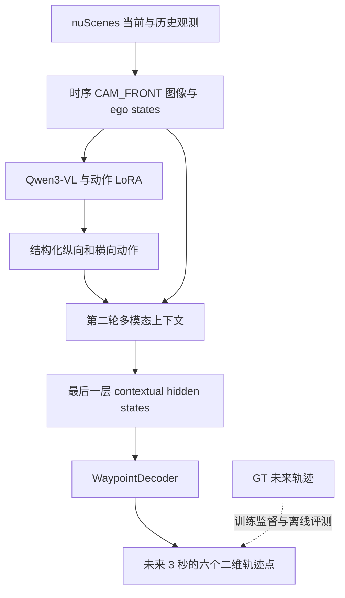
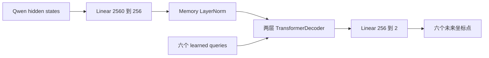
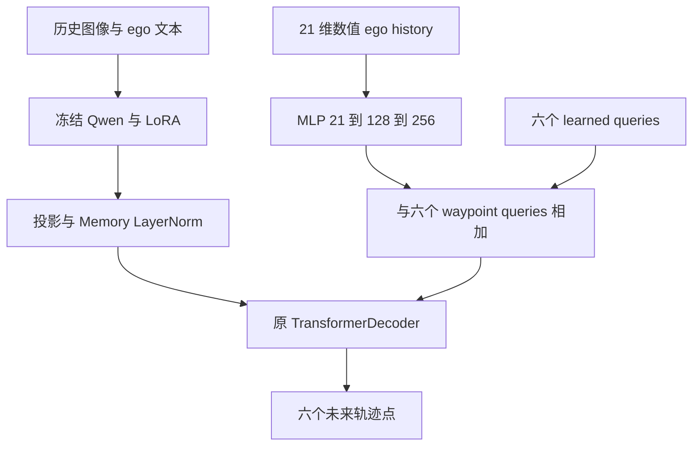

# 自动驾驶 VLA 项目学习与能力复盘

> [!abstract] 这份项目最值得讲清楚的内容
> 我从 nuScenes 数据对齐和动作标签构建出发，完成了 Qwen3-VL 结构化动作 LoRA、连续轨迹规划器、动力学基线和融合实验；过程中不仅让模型跑通，还通过真实训练故障诊断和受控比较，逐步回答了“模型在用什么信息、误差从哪里来、增加模块是否有收益”。

本笔记整理于 **2026-10-12**，依据 GitHub PR、Learning & Capability Closeout、实现代码和真实实验产物。按技术问题组织叙述，而非照搬提交顺序；历史总结中的“尚未运行”使用后续已确认结果更新。PR #53 及此前主线已合并，Fusion PR #54 当前为 Draft，其两轮真实实验已完成，结果来自本次提供并核验的运行产物。[^repo] [^fusion]

文中模型性能均指本项目 validation；当前系统是基于日志观测的开环 VLA 原型。BEV/OCC 安全评估、候选重排序和闭环交互属于后续路线，集中在末尾说明。

## 阅读导航

- [[#01 项目主线：把语言语义连接到连续运动]]
- [[#02 数据闭环：先让图像、轨迹和交通参与者对得上]]
- [[#03 数据集与评测：让后续模型站在同一把尺子上]]
- [[#04 动力学规则基线：先知道简单信息能做到什么]]
- [[#05 接入 Qwen：理解真正进入模型的多模态张量]]
- [[#06 LoRA 与监督位置：从模板文本走到真实训练信号]]
- [[#07 因子化动作：让语义接口能够表达组合运动]]
- [[#08 时序数据：把单帧判断升级为短历史理解]]
- [[#09 正式动作 SFT：得到可复用的语义决策模型]]
- [[#10 连续规划器：Qwen 表征怎样变成六个坐标点]]
- [[#11 核心调试案例：沿着计算图定位轨迹塌缩]]
- [[#12 完整轨迹训练：从能拟合到能泛化]]
- [[#13 基线与分层分析：定位轨迹能力来自哪里]]
- [[#14 收敛与 GT-action 诊断：拆开两种性能问题]]
- [[#15 No-action 消融：检验语义动作的净贡献]]
- [[#16 Fusion：把显式动力学接入多模态规划器]]
- [[#17 工程经验：让实验能够保存、复用和解释]]
- [[#18 能力地图与面试讲述]]
- [[#19 后续路线与证据索引]]

## 01 项目主线：把语言语义连接到连续运动

项目起初使用六类 coarse meta-action（粗粒度元动作）描述驾驶行为，随后逐步扩展为两个互补输出：**可读的纵向／横向语义动作，以及未来 3 秒的连续轨迹**。

这解决了两个不同层次的问题。语义动作回答“接下来大致如何运动”，例如减速、向左；轨迹回答“每个时刻具体到哪里”，例如 0.5 秒后和 3 秒后的坐标。前者便于解释和诊断，后者提供可计算的运动输出。



这张图表示 action-conditioned 主路径。后来 No-action 保留相同对话结构，把中间动作换成固定占位文本；Fusion 在此基础上再增加数值化 ego-history 输入。

**为什么采用这种拆分？** 如果直接让 Qwen 输出一串坐标，动作理解、数字生成、格式解析和运动建模会同时影响结果。使用专门的连续 decoder 后，可以分别研究语义决策和轨迹预测，也能直接对坐标计算回归损失。

**体现的能力：** 能把一个“做自动驾驶大模型”的宽泛目标分解成数据、表征、语义接口、连续动作和评测模块，并让每个模块有清楚的输入输出。[^planner]

## 02 数据闭环：先让图像、轨迹和交通参与者对得上

### 做了什么

建立一条以 `sample_token` 为索引的样本链路：

```text
sample_token
  → CAM_FRONT 图像
  → 当前自车位姿
  → 未来自车轨迹
  → 附近 3D agents
  → 一页式对齐可视化
  → 人工审核与动作标签
```

### 怎么做

通过 nuScenes 的 sample、sample_data、ego_pose 和 annotation 关联表找到同一观测对应的数据，再将全局坐标统一到**当前自车坐标系**：x 向前、y 向左、z 向上，长度单位为米。

设当前自车在全局坐标系中的位置为 $t_0$，旋转为 $R_0$，未来位置或其他交通参与者的全局位置为 $p_g$，则：

$$
p_{\mathrm{ego}}=R_0^\top(p_g-t_0).
$$

先减去当前位置，得到相对位移；再用当前旋转的逆变换，把位移表达在车身坐标系中。代码使用四元数逆旋转实现这一过程。所有未来点都映射到**同一个当前坐标系**，这样六个点才共同描述一条未来路径。[^geometry]

当前 ego pose 与 ego-motion 的时间源对齐 `CAM_FRONT sample_data`；未来轨迹沿既定时间网格选取，并保留时间容差。可视化将图像、轨迹和周围对象放到同一页，检查左右方向、运动趋势、场景末尾是否有足够未来数据，以及对象位置是否合理。

之后完成 **108 个样本人工审核**，图像／轨迹与 agents 对齐检查均为 108/108，覆盖六类动作；依据审核修订早期动作规则，并冻结 `phase-1.6-meta-action-v0.2`。[^data]

### 为什么这样做

模型训练会放大数据定义中的错误。左右翻转会把 left/right 标签整体颠倒；时间锚点混用会让图像对应错位的运动；场景末尾不足 3 秒会改变目标含义。先在单样本上把这些问题看清楚，再批量生成，比在 loss 异常后回查数据更直接。

### 体现什么能力

能够把多表传感器数据组织成统一样本，理解坐标变换、时间同步与标签语义，并用可视化和人工审核发现自动校验难以表达的问题。这是自动驾驶数据工程与几何理解的基础能力。

## 03 数据集与评测：让后续模型站在同一把尺子上

### 做了什么

先用已审核样本建立 manifest、统一评测和 Majority Baseline，再扩展到 nuScenes trainval，形成正式的 scene-level split（按场景切分）。[^dataset]

| 项目数据划分 | 场景数 | 有效样本数 |
| --- | ---: | ---: |
| Train | 560 | 14,253 |
| Validation | 140 | 3,594 |
| 历史 project test | 150 | 3,799 |

### 怎么做

官方 train 的 700 个 scenes 分为项目 train/validation；按场景的动作分布进行分层分配，让数据划分同时兼顾场景隔离与长尾类别覆盖。固定 seed 为 `20260710`。

未来轨迹定义为 **3 秒、0.5 秒间隔**，采样时间容差为 **0.075 秒**。全量扫描 34,149 个 samples，纳入 21,646 个，排除原因主要是未来时域不足和时间戳不满足容差。统计排除原因，才能判断样本减少来自正常筛选还是数据代码错误。

Manifest 保存样本身份、scene、图像路径、位姿、motion、目标和版本信息。`sample_token` 用于逐样本对齐，`scene_token` 用于场景隔离；模型输出保留这些字段，之后才能把两组预测一一比较。

分类评测同时记录 macro-F1、per-class F1、confusion matrix、类别分布和 invalid output rate。以 $C$ 类为例：

$$
\mathrm{macro\text{-}F1}=\frac{1}{C}\sum_{c=1}^{C}\mathrm{F1}_c.
$$

每类在平均中占同样权重，能暴露“多数类很好、少数类几乎不预测”的情况。Majority Baseline 只根据 train 的多数类做预测，提供最低成本的参照。

### 为什么这样做

相邻驾驶帧高度相似，按帧随机切分容易让训练和验证共享近乎相同的场景。按 scene 切分后，validation 更能反映模型在不同驾驶片段上的表现；固定样本集合与评测实现，则让后面的结构比较有共同基础。

### 体现什么能力

能够设计场景级数据划分、识别类别不平衡、建立可重复的目标与评测协议，并把样本覆盖率纳入性能解释。

## 04 动力学规则基线：先知道简单信息能做到什么

### 做了什么

使用当前和历史 ego pose 派生速度、纵向加速度、yaw rate，构建不依赖学习的六类动作规则基线。[^rule]

### 怎么做

速度来自相邻历史位置的位移与真实时间间隔，yaw rate 来自处理角度环绕后的朝向差与时间间隔；加速度使用相邻速度区间及其时间位置计算。历史不足时保留 full、partial、unavailable 状态，让下游知道缺失了什么。

规则先判断停车，再判断横向运动，再判断加减速，最后输出 keep。在预先定义的 625 组候选阈值中，用 validation 选择固定规则，得到：

| 阈值 | 取值 |
| --- | ---: |
| Stop speed | 0.2 m/s |
| Lateral yaw rate | 0.05 rad/s |
| Accelerate acceleration | 0.5 m/s² |
| Decelerate acceleration magnitude | 0.3 m/s² |

该规则的 validation macro-F1 为 **0.615681**，Majority Baseline 为 **0.087186**。结果说明当前／历史动力学本身已经包含很强的动作信息，之后的大模型需要和这个强参照比较。

### 为什么这样做

复杂模型的结果只有放在合理基线旁边才有意义。驾驶具有运动连续性：车辆已经在减速时，继续减速往往是合理预测；这个规律应先量化，再判断图像和语言表征是否提供增量。

### 一次真实工程教训

Phase 0.2d 的正式执行曾因 producer／consumer 的 JSON 字段层级不一致而失败：producer 把指标放在 `metrics` 内，consumer 却按顶层字段读取。修复随后采用真实 producer 生成 fixture，再测试 adapter 的规范化输出。原 project test 被记录为 `consumed_failed`，后续模型实验使用 train/validation。[^contract]

这件事带来的直接经验是：**接口测试应该来自真实生产者输出；“自己写的假输入能通过”不等于真实数据链路已经接通。**

### 体现什么能力

能够用车辆运动常识建立强基线，也能把运行失败定位到具体的数据合同，修复问题产生的位置，而不是靠继续调参掩盖工程错误。

## 05 接入 Qwen：理解真正进入模型的多模态张量

### 做了什么

将图像、任务文本和 ego-state 接入固定 revision 的 `Qwen/Qwen3-VL-4B-Instruct`，完成真实 GPU 推理、dataset adapter，以及完整 validation 的 zero-shot baseline。[^qwen]

### 怎么做

先把样本组织为 Qwen conversation，再由 processor 的 `apply_chat_template()` 生成实际模型输入：

| 字段 | 作用 |
| --- | --- |
| `input_ids` | 文本与多模态占位结构的 token 序列 |
| `attention_mask` | 标记有效序列位置 |
| `pixel_values` | processor 划分后的视觉 patch 输入 |
| `image_grid_thw` | 每张图像对应的时间／高度／宽度网格 |

真实样本曾观察到 `pixel_values [5600,1536]`、`image_grid_thw [[1,56,100]]`，经视觉编码与 merger 后得到 `[1400,2560]` 的 image embeddings。这里 **2560 是表征维度**，1400 是该图像的视觉 token 数；图像尺寸、数量和对话内容变化时，token 数随之变化。[^interface]

早期接口工作验证了公共 `get_image_features()` 接口；后来 two-turn planner 使用完整多模态 forward 的 `hidden_states[-1]`，以便轨迹表征包含图像、ego 文本和动作上下文。理解这次演进，需要分清三件东西：

```text
pixel_values：视觉编码器的输入
image_embeds：视觉编码与 merger 后的特征
hidden_states[-1]：完整多模态上下文处理后的最后一层表征
```

### Zero-shot 学到了什么

旧六类动作协议的结果如下：

| 输入 | Accuracy | Macro-F1 |
| --- | ---: | ---: |
| Image only | 0.4204 | 0.2331 |
| Image + ego state | 0.4602 | 0.2986 |

两组 parser success 都是 100%，但 left_lateral 预测数均为 0。问题已经从“能否输出合法格式”转向“能否识别正确运动语义”；ego-state 提供帮助，却还没有让 zero-shot 超过规则基线。

### 为什么这样做

大模型接入要同时理解自然语言接口和张量接口。仅能调用 `generate()`，不足以支撑后续训练与规划器开发；明确特征维度、图像顺序和 mask 语义，才能把 backbone 当作可复用模块。

### 体现什么能力

能够调试真实 VLM processor、理解动态视觉 token 与多图输入、区分视觉特征和上下文特征，并通过预测分布定位模型能力短板。

## 06 LoRA 与监督位置：从模板文本走到真实训练信号

### 做了什么

先建立小规模 LoRA 训练链路：多模态输入 → assistant target → loss → optimizer update → adapter 保存 → fresh reload → 再次预测。早期六类 smoke 验证了链路，后续扩展为结构化动作 SFT。[^lora-smoke]

### LoRA 怎样改变模型

对于冻结的线性权重 $W_0$，LoRA 学习低秩增量：

$$
W=W_0+\frac{\alpha}{r}BA.
$$

$A$ 把输入投影到 $r$ 维低秩空间，$B$ 再映射回输出维度；$W_0$ 固定，只更新 $A,B$。本项目在 attention 的 q/k/v/o projections 注入 LoRA，使用 `r=8`、`alpha=16`、`dropout=0.05`，可训练参数为 **5,898,240**。

这样既保留预训练的视觉语言能力，又能用相对小的训练成本适配驾驶动作任务。

### Assistant-only supervision 怎样实现

输入 conversation 含有任务指令、ego 文本、图像和 assistant 答案，但 loss 只监督 assistant 目标文本。其余 token 的 label 设为 `-100`，由交叉熵忽略。

真实 processor 暴露过一个很具体的问题：动作 `keep` 后面还有模板自动追加的 `<|im_end|>` 和换行。旧代码把整个 assistant suffix 当作 target，监督片段解码后变成 `keep\n`，与目标 `keep` 不一致。[^mask]

修复方式是在 token 层定位完整的 action lexical span，只给动作 token 填入有效 labels，将 terminator 和 newline 继续 mask。这样处理还自然支持由多个 token 构成的动作文本。

之后的结构化监督进一步使用 tokenizer 的 `offset_mapping`：定位纵向字段、分号、横向字段的字符区间，再映射到 token；纵向和横向分别依据 validity 决定是否参与监督，分号在两方向都有效时监督。

### 为什么这样做

训练目标由实际 label tensor 决定，而不是由屏幕上看起来正确的答案决定。若监督位置偏移，loss 即使下降，也可能在学习模板格式而非目标动作。

小样本阶段还检查 LoRA B 权重从零变为非零、参数确实更新，以及保存后重新加载能否复现行为，形成“输入 → 梯度 → 参数 → 预测”的完整证据链。

### 体现什么能力

能够理解 causal LM 的监督机制、排查 tokenizer/template 差异、实现 PEFT 参数控制，并验证 checkpoint 的实际可复用性。

## 07 因子化动作：让语义接口能够表达组合运动

### 做了什么

把旧版互斥六类动作升级为两个维度：

```text
Longitudinal：stop / decelerate / keep / accelerate
Lateral：left / straight / right

输出示例：longitudinal=decelerate; lateral=left
```

“减速并向左”可以同时成立，因此拆成纵向和横向更适合表达驾驶运动。两个字段由同一语言模型生成；语义上的因子化并不要求二者在概率上独立。[^factorized]

### 怎么做

新标签重新从未来轨迹派生。先提取路程、首尾速度 proxy、速度变化、最终横向位移和 heading 变化等连续量，再据分布和边界样本确定规则。

原始轨迹含当前锚点 $p_0$ 与未来六点 $p_1,\ldots,p_6$：

$$
v_{\mathrm{start}}=\frac{\|p_1-p_0\|_2}{t_1-t_0},\qquad
v_{\mathrm{end}}=\frac{\|p_6-p_5\|_2}{t_6-t_5},\qquad
\Delta v=v_{\mathrm{end}}-v_{\mathrm{start}}.
$$

这里使用真实 segment 时间间隔，速度是从位置差估计的 proxy。冻结规则为：

| 方向 | 判定规则 |
| --- | --- |
| Stop | 路程 ≤ 0.6 m，且末段速度 ≤ 0.6 m/s，优先判定 |
| Accelerate | 非 stop，且 $\Delta v\geq 1.0$ m/s |
| Decelerate | 非 stop，且 $\Delta v\leq-1.0$ m/s |
| Keep | 其余纵向情况 |
| Left / right | 最终横向位移分别 ≥ +1.0 m / ≤ −1.0 m |
| Straight | 其余横向情况 |

Left/right 在这里表示横向运动方向；转弯或变道还需要道路拓扑等信息才能进一步区分。

两个方向各自保留 validity 和 reason，joint validity 为二者逻辑 AND。正式派生得到 train 14,253、validation 3,594 条，并完成 28 条代表性／边界人工审核。

### 为什么这样做

直接把旧标签查表转换为两个字段，会继承旧版互斥类别丢失的信息。从连续运动重新派生，才能恢复“减速 + 横向运动”这类组合，并让语义动作与后续轨迹目标拥有共同几何来源。

### 体现什么能力

能够围绕下游任务设计动作空间，用连续运动统计构造可解释标签，并完成从数据分布、阈值到边界审核的闭环。

## 08 时序数据：把单帧判断升级为短历史理解

### 做了什么

构建当前帧加两帧历史观测的 temporal dataset，配对结构化动作与六点未来轨迹。[^temporal]

### 怎么做

历史长度固定为 3，按 oldest → current 排序；历史不足时左侧 null padding，并保存 `history_valid_mask`。只为真实观测加载图像，真实帧本身的 motion 是否可用由另一组 availability 描述。

```text
完整历史：[past_2, past_1, current] → [true, true, true]
短历史：  [null,   null,   current] → [false, false, true]
```

原始 future trajectory 有 **7 点**，包括 $t=0$ 的当前锚点；planner 的监督目标取 `[1:7]`，因此是 **6×2** 的未来坐标，而不是把当前原点也作为预测点。

选择三帧是数据覆盖和计算成本的折中：train / validation 完整三帧历史覆盖率约为 **94.55% / 94.63%**。全部 17,847 个 train/validation 样本保留；validation 中一／二／三帧有效历史分别为 94／99／3,401 条。

### 为什么这样做

单帧能够描述道路布局，却很难直接表达速度变化趋势。短历史补充运动线索；padding 与 availability 则让模型区分“数值为零”“没有这一帧”和“有图像但运动估计缺失”。

### 体现什么能力

能够设计多帧多模态输入、处理不完整历史、分离 source trajectory 与 model target，并保持时间顺序和几何目标一致。

## 09 正式动作 SFT：得到可复用的语义决策模型

### 做了什么

在完整 train 上训练结构化动作 LoRA，得到后续所有 Qwen planner 共用的 `adapter_step_3564`。[^sft]

### 怎么做

先对固定 12 条 train 样本进行小规模过拟合，确认两个动作字段、真实 processor、loss、参数更新和 fresh reload 都能配合工作，再进入正式训练。

正式配置使用一轮训练、micro batch 1、梯度累积 4、AdamW、学习率 $10^{-4}$、3% warmup 后 cosine schedule、BF16 和 gradient checkpointing。优化器更新次数为：

$$
\left\lceil\frac{14253}{4}\right\rceil=3564.
$$

每累积一组样本的归一化梯度再更新参数；最后不足四条的一组按实际组大小处理。训练关闭 KV cache，验证生成时启用 cache。

在 steps 891、1782、2673、3564 保存 adapter 并评估完整 validation，按双方向 macro-F1 的均值等固定顺序选优，最终选中 step 3564，再重新加载 base + adapter 复核全部预测。

| 指标 | 模型 | Train-derived majority |
| --- | ---: | ---: |
| Longitudinal macro-F1 | **0.684037** | 0.155086 |
| Lateral macro-F1 | **0.817588** | 0.294038 |
| Joint accuracy | **0.647468** | 0.336672 |

动作解析成功率为 100%。横向预测覆盖 left、straight、right，早期 zero-shot 的 left 类塌缩得到改善；纵向仍更困难，典型错误是 decelerate→keep、accelerate→keep。

### 为什么这样做

Joint accuracy 要求两个字段同时正确，直接反映整个动作接口的可靠性；方向 macro-F1 则帮助定位哪一部分更弱。将模型保存成 adapter 后，后续 planner 可以复用同一语义模型，避免每次实验同时改变上游表征。

### 体现什么能力

能够完成多模态 SFT 的正式训练、显存相关配置、checkpoint 选择、全量验证和错误分析，并形成可被后续模块消费的模型产物。

## 10 连续规划器：Qwen 表征怎样变成六个坐标点

### 做了什么

实现 two-turn action-conditioned planner：第一轮预测语义动作，第二轮将动作加入对话上下文，由连续 decoder 输出未来轨迹。[^planner]

### 两轮对话如何连接

```text
User：历史图像 + ego states + 动作任务
Assistant：longitudinal=...; lateral=...
User：根据上述观测与动作规划未来轨迹
                  ↓
Qwen contextual forward
                  ↓
hidden_states[-1]
```

动作通过真实 assistant context tokens 进入 Qwen，改变第二轮的上下文表征。训练时使用 GT action 做 teacher forcing，让 planner 先学习正确语义条件下的轨迹映射；正式预测使用 Qwen 自己生成的 action。GT-action validation 另用于诊断。

### Decoder 的计算过程

记最后一层 hidden states 为 $H\in\mathbb{R}^{B\times L\times2560}$，$L$ 是动态序列长度。先投影并归一化：

$$
M=\operatorname{LayerNorm}(HW_p+b_p),\qquad
M\in\mathbb{R}^{B\times L\times256}.
$$

模型有六个可学习的 waypoint queries，分别对应 0.5、1.0、1.5、2.0、2.5、3.0 秒。两层、四头 TransformerDecoder 让 queries 在 self-attention 中交互，并通过 cross-attention 读取 $M$，最后线性投影为 $[B,6,2]$。



Qwen 与 LoRA 都冻结，只训练约 **2.765M** 参数的 planner。冻结特征提取用 `torch.no_grad()`；decoder 参数仍参与反向传播。

### 连续轨迹怎样训练

使用 masked SmoothL1。对单个坐标误差 $e$，$\beta=1$ 时：

$$
\ell(e)=
\begin{cases}
\frac{e^2}{2\beta}, & |e|<\beta,\\
|e|-\frac{\beta}{2}, & |e|\geq\beta.
\end{cases}
$$

小误差采用平滑二次惩罚，大误差使用线性增长；对有效时间点的 x、y 坐标取平均。这样可以直接优化连续位置，而无需把坐标离散成语言 token。

### 为什么这样做，体现什么能力

Qwen 提供多模态语义表征，轻量 decoder 负责精确的连续输出。这一设计体现了 VLM 到连续动作接口的构建能力，以及对 attention query、特征维度、冻结策略和回归目标的理解。

## 11 核心调试案例：沿着计算图定位轨迹塌缩

这是整个项目中最值得详细复盘的技术案例。[^collapse]

### 现象：loss 下降，但八条样本仍然学不好

初版 planner 在 tiny-overfit 中表现不佳。增加训练步数，以及改为每一步累计完整八条样本的平均梯度，都没有解决问题；不同样本、甚至同一样本六个时刻的输出逐渐趋向同一个折中位置。

这个现象叫 trajectory collapse（轨迹塌缩）：网络通过输出一种平均答案降低部分损失，却没有学会输入到不同轨迹的映射。

### 排查：从输出一路追到 attention logits

| 排查位置 | 观察 | 推进了什么判断 |
| --- | --- | --- |
| GT、mask、时间点对齐 | 六个时刻收到不同的输出梯度 | 监督确实要求六个不同点 |
| Learned queries | 初始 query 之间仍明显不同 | Query embedding 本身没有整体塌缩 |
| Decoder Layer 1 / 2 | 差异主要在第二层消失 | 将范围缩小到具体 decoder layer |
| Cross-attention | 不同 query 读到几乎相同的 context | 检查读取 memory 的过程 |
| Attention mask | 上千个 token 有效 | 排除只放开一个 token 的 mask 错误 |
| Attention logits | top-1 中位数约 954，top-1/top-2 差约 827 | Softmax 已严重饱和 |
| Projected memory | 特征 RMS 随优化增大 | 上游数值尺度是关键线索 |

Cross-attention 的核心为：

$$
A=\operatorname{softmax}\left(\frac{QK^\top}{\sqrt{d_k}}\right),\qquad O=AV.
$$

当最大 logit 比其余值高出数百时，softmax 几乎变成 one-hot。如果六个 waypoint queries 都选择同一个 memory token，就会得到相同的 context；此时后续 Post-LN 又强烈压缩了残差中留下的 query 差异。

因此形成一条可检查的解释链：

```text
Projected memory 尺度增长
  → QK logits 变大
  → softmax 饱和
  → queries 读取相同 context
  → query 表征差异消失
  → 六个 waypoint 趋于相同
```

### 修复：在 memory 进入 decoder 前加 LayerNorm

保留 backbone、八条样本、优化设置、decoder 层数与 Post-LN，只在 projection 后增加：

```python
memory = self.context_projection(hidden_states)
memory = self.memory_norm(memory)
```

`LayerNorm(256)` 只增加 512 个可训练参数。其作用是对每个 token 的特征维度归一化：

$$
\operatorname{LN}(z)=\gamma\odot
\frac{z-\mu(z)}{\sqrt{\sigma^2(z)+\epsilon}}+\beta_{\mathrm{LN}}.
$$

这里 $\gamma$ 和 $\beta_{\mathrm{LN}}$ 是可学习的缩放与偏移；$\beta_{\mathrm{LN}}$ 与 SmoothL1 的参数不是同一含义。

修复后的真实八样本实验：

| 指标 | 训练前 | 训练后 |
| --- | ---: | ---: |
| Loss | 5.2900 | **0.02081** |
| ADE | 10.5019 m | **0.2593 m** |
| FDE | 18.2182 m | **0.2459 m** |

进一步观察发现，raw projection 的数值仍会增长，但 **decoder 真正收到的 normalized memory RMS 保持在约 1**；不同 queries 开始形成不同 attention pattern。

### 为什么这个调试有价值

修复针对的是模块接口的尺度，而不是用更多训练掩盖症状。它说明接入预训练大模型时，特征维度匹配只是第一步，数值分布也必须适合下游网络。

### 体现什么能力

能够依据实际计算图追踪输出、梯度、中间表征和 attention，区分监督问题、mask 问题与数值饱和，并用单变量修改验证根因假设。这比“遇到 loss 平台就调整学习率”更能展示深度学习调试能力。

## 12 完整轨迹训练：从能拟合到能泛化

### 做了什么

将通过 tiny-overfit 的 planner 扩展到完整 train/validation，固定 Qwen、LoRA 和已修复的 decoder 架构。[^full-planner]

### 怎么做

正式初始实验训练一轮，micro batch 1、accumulation 4、AdamW，学习率和 weight decay 均为 $10^{-4}$，使用 constant scheduler。与动作 LoRA 的 warmup/cosine 区分开，因为这里训练的是新初始化的小型 planner。

四个 validation checkpoints 的 ADE / FDE 约为：

```text
891 steps   → 2.428 / 5.002 m
1782 steps  → 1.479 / 3.153 m
2673 steps  → 1.335 / 2.748 m
3564 steps  → 1.188 / 2.337 m
```

持续改善表明 Memory LayerNorm 修复在完整数据训练中也能工作，并且一轮结束时模型仍在进步。这成为后续收敛检查的动机。

### ADE 和 FDE 具体是什么

对样本 $i$ 的六个预测点，定义位置误差 $d_{i,t}=\|\hat p_{i,t}-p_{i,t}\|_2$。全部点有效时：

$$
\mathrm{ADE@3s}=\frac{1}{N}\sum_{i=1}^{N}\frac{1}{6}\sum_{t=1}^{6}d_{i,t},
\qquad
\mathrm{FDE@3s}=\frac{1}{N}\sum_{i=1}^{N}d_{i,6}.
$$

ADE 评价整条预测轨迹的平均位置误差，FDE 更强调最终落点。带 mask 时按每条样本的有效点计算，再跨样本平均；1/2/3 秒 FDE 使用各自对应端点。

### 为什么这样做，体现什么能力

Tiny-overfit 解决“能否学习映射”，完整 validation 解决“在未参与梯度更新的场景上表现如何”。保存每个 checkpoint 的逐样本输出，使训练曲线、最终选择和后续诊断都能回到同一份轨迹证据。

## 13 基线与分层分析：定位轨迹能力来自哪里

### 做了什么

建立从简单动力学到多模态规划的基线层级，并按照动作、运动信息可用性和历史长度分析结果。[^baselines] [^strata]

| 模型 | 输入与结构 | 要回答的问题 |
| --- | --- | --- |
| Constant Velocity，CV | 当前 speed，$x_t=vt,y_t=0$ | 不学习，仅运动外推能做到多少？ |
| Ego-History MLP | 数值历史 → 小 MLP → 轨迹 | 学到的动力学有多强？ |
| Direct Qwen | 多模态观测 → hidden states → decoder | 直接用多模态表征表现如何？ |
| Action-conditioned Qwen | 观测 → 动作 → contextual states → decoder | 显式语义动作接口增加了什么？ |

### Ego-History MLP 怎样编码输入

每帧包含七个值：归一化 speed、speed availability、归一化 acceleration、acceleration availability、归一化 yaw rate、yaw-rate availability、history validity。

三帧展平为 21 维，经 `21→128→GELU→128→GELU→12` 输出六点轨迹。均值与标准差只从 train 的可用历史值拟合；缺失数值置为归一化空间的零，并保留对应 mask。

它以 CPU、batch 256、20 epochs 训练，选中 epoch 16，validation ADE / FDE 为 **0.814533 / 1.772458 m**。这是强动力学参照；它与 Qwen 实验的训练预算不同，理解排名时应同时记住这一设计。

### 为什么先做 Direct，再做 No-action

早期 Direct 同时移除了 assistant action 和第二轮对话，改成一轮直接规划提示。它在一轮训练后为 **1.237128 / 2.397061 m**，略差于同期 action-conditioned 的 **1.187892 / 2.337162 m**。

这个实验回答“另一条更直接的路径能否更好”；由于对话形式也改变了，后来又设计保留两轮结构的 No-action，进一步缩小比较变量。

### 分层分析改变了什么认识

完整 validation 上 MLP 很强，但 motion-unavailable 的 94 个样本上，多模态路径明显更好。CV 在这 94 条上缺少当前速度，产生明确 invalid，剩余共同有效集合为 3,500 条；因此 CV 的 3,500 样本指标和其他模型的 3,594 样本指标分别报告。

这一步把问题从“谁的平均 ADE 更低”推进为“谁在什么输入条件下更好”，也引出了显式动力学与多模态表征融合的动机。

### 体现什么能力

能够建立有解释力的基线层级、识别样本分母差异，并通过分层比较形成下一步可检验的问题，而非单纯追逐总体排名。

## 14 收敛与 GT-action 诊断：拆开两种性能问题

### 做了什么

固定架构和训练协议，把 action-conditioned planner 跑到第三轮，并用相同 checkpoint 比较 predicted action 与 GT action。[^convergence]

| Epoch | Train loss | Predicted-action ADE@3s | Predicted-action FDE@3s |
| --- | ---: | ---: | ---: |
| 1 | 0.792669 | 1.248157 | 2.425711 |
| 2 | 0.343750 | **0.992346** | **2.035392** |
| 3 | 0.282169 | 1.078463 | 2.142418 |

第一轮到第二轮明显进步；第三轮 train loss 继续下降，但 validation 回退，因此选择 Epoch 2，并停止向 Epoch 4–5 扩展。

### 怎样区分动作错误与训练回退

固定 decoder checkpoint，只把动作上下文替换为 GT：

| 条件 | Epoch 2 ADE / FDE | Epoch 3 ADE / FDE |
| --- | --- | --- |
| Predicted action | 0.992346 / 2.035392 | 1.078463 / 2.142418 |
| GT action | **0.810181 / 1.541940** | 0.928545 / 1.748152 |

由此得到两个同时成立的认识：

1. **动作预测误差影响最终规划。** Epoch 2 换成正确动作后，ADE / FDE 改善约 18.4% / 24.2%。
2. **Epoch 3 回退还有 planner 泛化方面的原因。** 即使用正确动作，第三轮仍然变差，因此 action prediction error 无法单独解释这次回退。

这就是 oracle diagnostic 的作用：人为提供正确的中间变量，观察下游还剩下什么问题。

### 历史复现问题怎样处理

新 run 的 Epoch 1 没有通过与旧实验相差 1% 以内的复现门槛。样本与配置已核对一致，BF16/GPU 数值路径分叉是待验证解释；后续结论采用同一 run 内的 Epoch 1→2→3 比较，保留原失败记录。

### 体现什么能力

能够结合训练曲线、checkpoint 选择和中间变量替换做误差诊断，并区分“上游预测质量不足”和“下游继续训练后泛化变差”。

## 15 No-action 消融：检验语义动作的净贡献

### 做了什么

训练一个匹配两轮预算的 No-action planner。所有样本的 assistant context 固定为：

```text
structured_action=unavailable
```

保留相同历史图像、ego-state 文本、两轮对话形式、Qwen/LoRA、decoder 结构和优化设置，重新训练 decoder 两轮。[^noaction]

### 为什么需要重新训练

原 planner 学习的是 action-conditioned representation。只在推理时删掉 action，会同时改变输入分布；重新训练固定中性条件的 decoder，才能更直接地比较这条信息路径的实际作用。

No-action 仍然是多模态输入，并且 Qwen 使用原来的动作 LoRA；实验移除的是每个样本显式给出的语义动作值。

### 得到什么结果

| 路径 | ADE@3s | FDE@3s |
| --- | ---: | ---: |
| Predicted-action Epoch 2 | 0.992346 | 2.035392 |
| No-action Epoch 2 | **0.954674** | **1.947383** |
| GT-action Epoch 2 | **0.810181** | **1.541940** |
| Ego-History MLP | 0.814533 | 1.772458 |

No-action 比 predicted-action 改善约 **3.8% ADE / 4.3% FDE**，但仍不及 GT-action。结合上一节同 checkpoint 的诊断，可以形成连贯解释：正确语义动作能帮助规划，而当前预测动作中的错误会传递到下游，抵消部分价值。

因此，“语义动作具有信息价值”和“当前显式预测动作没有取得净收益”并不矛盾。一个中间变量是否值得保留，既取决于它表达什么，也取决于上游能否足够准确地预测它。

### 体现什么能力

能够设计匹配训练预算的消融，理解中间表征、显式条件和输入分布之间的关系，并用实验结果调整对模块价值的判断。

## 16 Fusion：把显式动力学接入多模态规划器

### 做了什么

在 No-action 路径上增加一个轻量 ego encoder，检验显式数值动力学能否补充 Qwen 的多模态表征。[^fusion]

### 怎么融合

复用 Ego-History MLP 的 21 维历史编码，构建：

$$
e=\mathrm{MLP}_{21\rightarrow128\rightarrow256}(x_{\mathrm{ego}}),\qquad
q'_t=q_t+e,\quad t=1,\ldots,6.
$$

MLP 中间使用 GELU。每个 waypoint query 保留自己的时间身份 $q_t$，同时接收相同的 ego embedding $e$，随后通过原 decoder 读取 Qwen memory。



这是 **query conditioning**：ego 状态影响 query 如何读取多模态 memory。新增 35,840 个参数，总可训练参数 **2,800,898**；归一化统计只从 train 拟合，与 checkpoint 一起保存。Qwen/LoRA 冻结，fresh planner 和 ego encoder 固定训练两轮，选择 Epoch 2。

### 为什么选择这个最小方案

数据编码、decoder 和训练循环都已可用，query 加法只需要一个小 MLP，能迅速检验显式动力学路径的价值，同时保持实现容易理解和复用。

### 真实结果说明了什么

| 模型 | ADE@3s | FDE@3s |
| --- | ---: | ---: |
| Fusion Epoch 2 | **0.956734** | **1.944508** |
| No-action Epoch 2 | 0.954674 | 1.947383 |
| Predicted-action Epoch 2 | 0.992346 | 2.035392 |
| GT-action Epoch 2 | 0.810181 | 1.541940 |
| Ego-History MLP | 0.814533 | 1.772458 |

Fusion 对比 No-action：

| 时间范围 | ADE 变化 | FDE 变化 |
| --- | ---: | ---: |
| 1 秒 | **−10.20%** | **−11.01%** |
| 2 秒 | **−4.69%** | **−5.40%** |
| 3 秒 | +0.22% | −0.15% |

最清楚的结论是：**显式 ego 融合改善了近期预测，但 3 秒总体误差基本持平。** 在 94 个 motion-unavailable 样本上，Fusion 为 3.254925 / 5.417337 m，No-action 为 3.064186 / 5.125190 m，Fusion 反而变差约 6.22% / 5.70%。这 94 条均只有一个有效历史帧。

从训练曲线看，Fusion loss 为 0.643621→0.328384，ADE 为 0.978275→0.956734，FDE 为 2.000275→1.944508；两轮训练完整，验证预测全部有效。

### 从这个结果学到了什么

Qwen 原输入已经含有 ego-state 文本，所以数值支路提供的是另一种编码与注入方式。把两个有用输入放在一起，效果还取决于融合位置、优化过程和缺失信息处理。当前方案的收益主要出现在短期，未表现为整体 3 秒优势；这一结果让后续选择更具体，而不是笼统地认为“多加一个模态就会更好”。

### 体现什么能力

能够完成从实验动机、数值特征编码、模型融合、联合优化到 checkpoint 持久化的实现，并根据真实结果评价设计，而不是只用架构复杂程度证明工作价值。

## 17 工程经验：让实验能够保存、复用和解释

### 训练结束不等于模型产物已经可用

LoRA 保存 adapter；planner 保存 decoder 参数与配置；Fusion 还保存 normalization stats。Fresh reload 将这些组件重新组合并执行推理，检查保存的产物能否重建同一个计算过程。

这体现对模型生命周期的理解：数据预处理状态、训练权重和推理配置共同决定模型行为。

### 比较结果要回到逐样本预测

每条输出保留 `sample_token`、`scene_token`、GT、mask、预测坐标和有效性。比较时先对齐身份与目标，再复用统一 evaluator 重算 ADE/FDE；同时记录 pairwise delta、胜／负样本数和覆盖率。

这能发现“平均数很接近但样本集合不同”，也能区分“少量大改善拉低均值”与“多数样本都改善”。例如 Fusion 相对 No-action 的 ADE／FDE 胜率约为 48.8%／48.5%，与总体基本持平的解释一致。

### 区分模型故障与运行环境故障

根据用户的运行记录，No-action 训练曾两次中断：一次伴随 GPU／进程消失，另一次出现 SIGINT，且观察到 SSH 重连相关现象。中途 loss 不能代替完整实验，因此保留中断目录，重新完成两轮运行。

后续使用离线模型缓存和 `nohup + logfile + PID` 启动方式，降低网络请求与交互终端对长任务的影响。`nohup` 主要解决终端挂断相关问题，实例停止仍需要通过运行环境管理处理。

这一经验体现的是分层排错：先根据 traceback、signal、GPU 和进程状态定位故障层，再决定修训练代码还是执行方式。

### 工程复杂度应该服务于模型问题

项目逐步形成了这样的节奏：先保证输入输出正确，再进行足够的小规模验证，随后运行完整实验；发现问题时优先排查数据、监督、表征和数值尺度。已有结论清楚后，将实现和分析收尾，而不是持续增加机制。

## 18 能力地图与面试讲述

### 把项目经历转成具体能力

| 能力 | 项目中的具体工作 | 面试时可展开的技术点 |
| --- | --- | --- |
| 自动驾驶数据工程 | nuScenes 样本对齐、manifest、时序历史 | 表关联、坐标变换、时间容差、scene split |
| 任务与标签设计 | 六类动作到纵横因子化动作 | 组合动作、速度 proxy、阈值与标签审核 |
| 多模态模型接口 | Qwen processor 与特征接口 | 图像 patch、动态 token、image embeds 与 hidden states |
| 参数高效微调 | 结构化动作 LoRA | 低秩更新、assistant mask、offset mapping、梯度累积 |
| 连续动作建模 | Learned queries + TransformerDecoder | Cross-attention、SmoothL1、时间点身份、ADE/FDE |
| 深度学习调试 | Attention saturation 与轨迹塌缩 | 逐层表征、logit scale、LayerNorm、单变量修复 |
| 实验设计 | CV、MLP、Direct、GT、No-action、Fusion | 基线层级、预算与样本对齐、oracle 诊断 |
| 结果解释 | 动作瓶颈、Epoch 3 回退、Fusion 局部收益 | 将总体指标拆到 horizon、子集和错误来源 |
| 模型工程 | Adapter／planner 保存与重载、长任务执行 | 权重与预处理状态、配置、日志、运行环境定位 |

这些能力最有说服力的表达方式，是给出一件具体问题及处理过程。例如“我定位过 cross-attention 饱和导致的 query collapse，并通过 memory normalization 修复”，比“我熟悉 Transformer”更容易展开讨论。

### 两分钟项目介绍

> 我的项目是基于 nuScenes 和 Qwen3-VL 的自动驾驶 VLA 原型，输入是短历史前视图像和自车状态，输出包括结构化纵横动作以及未来 3 秒的六个轨迹点。
>
> 我先做了数据层：统一图像、位姿和未来轨迹的坐标与时间，按 scene 切分数据，并从未来运动派生动作标签。之后把旧的互斥六分类改为纵向四类、横向三类，让模型能表达减速并向左这类组合行为。
>
> 模型层使用 Qwen3-VL-4B 做结构化动作 LoRA，纵向和横向 macro-F1 分别约为 0.684 和 0.818。轨迹不是让 Qwen 输出坐标字符串，而是把最后一层多模态 hidden states 接到一个约 2.8M 参数的 Transformer decoder，用六个 learned queries 回归未来坐标。
>
> 最有代表性的调试是 planner 在八样本训练中发生轨迹塌缩。我逐层检查梯度、query 表征和 attention，发现 projected memory 尺度增长使 cross-attention softmax 饱和；在 projection 后加 LayerNorm，八样本 ADE 从训练前约 10.5 米降到 0.26 米，之后再扩展到完整训练。
>
> 我还用动力学 MLP、GT-action 和 No-action 消融分析性能来源：正确动作可以改善轨迹，但当前预测动作的错误会传递到下游；显式 ego Fusion 改善了 1–2 秒预测，3 秒整体与 No-action 基本持平。这让我能具体解释系统中各条信息路径的作用，而不仅仅报告一个最终分数。

### 十个值得准备的追问

**1. 为什么动作标签来自未来轨迹，而输入只用历史？**

因为学习目标就是根据当前信息预测未来行为。未来轨迹定义训练 target，当前／历史观测定义 inference input；二者职责不同。

**2. 为什么选择纵向四类、横向三类？**

驾驶运动可以同时具有纵向和横向分量，分开描述能保留组合语义；每个方向还可以独立评测和分析错误。

**3. 为什么只训练 LoRA 和小 planner？**

LoRA 用较低训练成本完成动作适配；固定该 backbone 后训练 planner，可以集中研究表征到连续轨迹的映射，并让消融共享上游模型。

**4. 六个 queries 如何知道自己对应哪个未来时刻？**

它们是六组独立的可学习 embedding，输出槽位固定与六个目标时刻对应；逐时间点监督让各 query 学习不同的时间角色。

**5. 为什么 Transformer 里已经有 LayerNorm，还要在 memory 上加？**

Decoder 内部的 LayerNorm 不等于已对输入 memory 进行尺度控制。Cross-attention 的 K/V 来自 memory，上游尺度可能先使 logits 饱和；在接口处归一化可以直接控制进入 attention 的特征分布。

**6. 为什么 loss 下降仍可能训练失败？**

输出平均轨迹也能降低部分损失。还需要看不同样本、不同时间点是否产生合理差异，以及在小样本上能否真正拟合。

**7. 为什么 MLP 能超过大模型路径？**

三秒运动具有很强的连续性，显式速度、加速度、yaw rate 是直接且有用的特征；多模态信息的潜在价值还需要合适的表征与规划接口才能转化成数值精度。

**8. GT-action 诊断与 No-action 消融有什么区别？**

GT 诊断固定 planner，替换动作条件，观察上游错误的影响；No-action 重新训练固定中性条件的 planner，比较保留或去除显式动作信息后的表现。

**9. 为什么加入 Fusion 后没有全面提升？**

原 Qwen 输入已含 ego 文本，数值分支改变了编码与注入方式。当前加法条件化改善了近期运动预测，但总体增益和缺失子集表现并未同步改善，这说明融合效果需要由实际任务验证。

**10. 这个项目为什么属于 VLA？**

系统把视觉与语言上下文连接到可执行接口所需的动作表征：高层有结构化语义决策，低层有连续轨迹。其技术核心是多模态条件下的动作建模；显式 ego 状态是这条链路中的辅助信息。

## 19 后续路线与证据索引

### 下一层技术问题

当前主线已经回答数据、语义动作和轨迹预测的问题。若继续扩展，最自然的新问题是“轨迹与交通参与者的空间关系如何评价”，对应既有规划中的 BEV/OCC 几何评估、候选轨迹与离线 reranking；它们会把单纯的轨迹误差扩展到风险、进度与舒适性。DiT、Flow Matching 和 RL 则可以在明确需要生成多种动作分布或进行交互优化时另行考虑。

### 源码阅读入口

以下链接固定到已核验 commit，方便在 Obsidian 中独立阅读本笔记时跳回代码。

| 想理解的问题 | 入口 |
| --- | --- |
| 坐标变换与数据闭环 | [inspect_nuscenes_sample.py](https://github.com/TNAG031231/4vla_learning/blob/fd73872840dcd5e2371137adbd3a2e7d583261aa/data/inspect_nuscenes_sample.py) |
| 因子化动作特征与规则 | [phase0_4_factorized_targets.py](https://github.com/TNAG031231/4vla_learning/blob/fd73872840dcd5e2371137adbd3a2e7d583261aa/src/phase0/phase0_4_factorized_targets.py) |
| 三帧历史与六点目标 | [phase0_4_temporal_dataset.py](https://github.com/TNAG031231/4vla_learning/blob/fd73872840dcd5e2371137adbd3a2e7d583261aa/src/phase0/phase0_4_temporal_dataset.py) |
| Token masking 与结构化动作 | [phase0_4b_protocol.py](https://github.com/TNAG031231/4vla_learning/blob/fd73872840dcd5e2371137adbd3a2e7d583261aa/src/phase0/phase0_4b_protocol.py) |
| Two-turn 与 WaypointDecoder | [phase0_4c_two_turn_planner.py](https://github.com/TNAG031231/4vla_learning/blob/fd73872840dcd5e2371137adbd3a2e7d583261aa/src/phase0/phase0_4c_two_turn_planner.py) |
| 轨迹指标计算 | [phase0_4c_evaluation.py](https://github.com/TNAG031231/4vla_learning/blob/fd73872840dcd5e2371137adbd3a2e7d583261aa/src/phase0/phase0_4c_evaluation.py) |
| 21 维数值状态编码 | [ego_history_mlp.py](https://github.com/TNAG031231/4vla_learning/blob/fd73872840dcd5e2371137adbd3a2e7d583261aa/src/baselines/ego_history_mlp.py) |
| No-action 的训练与比较 | [phase0_4c_no_action.py](https://github.com/TNAG031231/4vla_learning/blob/fd73872840dcd5e2371137adbd3a2e7d583261aa/src/phase0/phase0_4c_no_action.py) |
| Ego-query Fusion | [phase0_4c_ego_fusion.py](https://github.com/TNAG031231/4vla_learning/blob/f2b8eba06b3a500dbff93f05b4f89e2a4b081f4b/src/phase0/phase0_4c_ego_fusion.py) |

### 实验产物定位

实际训练与预测数据保存在仓库外的 `$VLA_DERIVED_ROOT/phase_0_4/`，笔记中的主要实验可以按以下目录回查：

| 实验 | 相对目录 | 优先阅读 |
| --- | --- | --- |
| Structured-action LoRA | `structured_action_lora_full_v0_1/` | 最终 validation 指标、prediction、adapter metadata |
| 初始完整 planner | `two_turn_planner_full_v0_1/` | Training summary、正式与 GT diagnostic predictions |
| Ego-History MLP | `ego_history_mlp_baseline_v0_1/` | `validation_predictions.jsonl`、normalization、reload |
| 收敛诊断 | `action_conditioned_convergence_v0_1/` | 各 epoch metrics、Epoch 2/3 GT-action predictions |
| No-action | `no_action_ablation_v0_1/` | `comparison.json`、`motion_unavailable_comparison.json` |
| Fusion | `ego_fusion_v0_1/` | 两轮 metrics、comparison、normalization、training summary |

Fusion 本次导出的 14 个 JSON/JSONL 文件中，`run_metadata.json` 记录执行 commit `f2b8eba06b3a500dbff93f05b4f89e2a4b081f4b`。2026-10-12 的离线分析核对了两轮训练顺序、每轮 14,253 个唯一 train tokens、3,594 个 validation 样本，以及与四组基线的逐样本目标对齐和指标重算；原始导出文件保持不变。

### GitHub 与 Closeout 来源

[^repo]: [GitHub 仓库](https://github.com/TNAG031231/4vla_learning)；[进度记录快照](https://github.com/TNAG031231/4vla_learning/blob/fd73872840dcd5e2371137adbd3a2e7d583261aa/docs/progress.md)。PR 状态于 2026-10-12 查询，历史阶段状态按后续实验记录更新。
[^geometry]: [坐标变换实现](https://github.com/TNAG031231/4vla_learning/blob/fd73872840dcd5e2371137adbd3a2e7d583261aa/data/inspect_nuscenes_sample.py)，见 `transform_global_point_to_ego` 与 `transform_pose_to_current_ego_frame`。
[^data]: [PR #3 人工审核流程](https://github.com/TNAG031231/4vla_learning/pull/3)、[PR #5 审核扩展](https://github.com/TNAG031231/4vla_learning/pull/5)、[PR #7 规则修订](https://github.com/TNAG031231/4vla_learning/pull/7)、[PR #9 标签冻结](https://github.com/TNAG031231/4vla_learning/pull/9)。
[^dataset]: [PR #11 seed-subset 与评测](https://github.com/TNAG031231/4vla_learning/pull/11)、[PR #13 trainval manifest](https://github.com/TNAG031231/4vla_learning/pull/13)。
[^rule]: [PR #14 motion 输入审计](https://github.com/TNAG031231/4vla_learning/pull/14)、[PR #15 规则基线](https://github.com/TNAG031231/4vla_learning/pull/15)、[PR #16 规则分析与冻结](https://github.com/TNAG031231/4vla_learning/pull/16)。
[^contract]: [PR #19 正式执行失败记录](https://github.com/TNAG031231/4vla_learning/pull/19)、[PR #20 artifact contract 修复](https://github.com/TNAG031231/4vla_learning/pull/20)。
[^qwen]: [PR #24 单样本 Qwen 接入](https://github.com/TNAG031231/4vla_learning/pull/24)、[PR #27 dataset adapter](https://github.com/TNAG031231/4vla_learning/pull/27)、[PR #31 zero-shot 结果](https://github.com/TNAG031231/4vla_learning/pull/31)、[PR #36 失败分析](https://github.com/TNAG031231/4vla_learning/pull/36)。
[^interface]: [PR #37 Learning & Capability Closeout](https://github.com/TNAG031231/4vla_learning/pull/37#issuecomment-5544898718)。该阶段验证 visual feature 接口，后续 two-turn 的实际 contextual feature 接口见 PR #47。
[^lora-smoke]: [PR #32 Learning & Capability Closeout](https://github.com/TNAG031231/4vla_learning/pull/32#issuecomment-5491250963)、[PR #35 真实 LoRA smoke 记录](https://github.com/TNAG031231/4vla_learning/pull/35)。
[^mask]: [PR #34 token supervision 修复与 Closeout](https://github.com/TNAG031231/4vla_learning/pull/34#issuecomment-5492398739)；结构化字段监督见 [PR #45 Closeout](https://github.com/TNAG031231/4vla_learning/pull/45#issuecomment-5675910624)。
[^factorized]: [PR #39 source contract Closeout](https://github.com/TNAG031231/4vla_learning/pull/39#issuecomment-5595367685)、[PR #41 calibration features Closeout](https://github.com/TNAG031231/4vla_learning/pull/41#issuecomment-5600145982)、[PR #43 factorized targets Closeout](https://github.com/TNAG031231/4vla_learning/pull/43#issuecomment-5638160020)。
[^temporal]: [PR #44 temporal dataset Closeout](https://github.com/TNAG031231/4vla_learning/pull/44#issuecomment-5652959855)。
[^sft]: [PR #45 structured-action smoke Closeout](https://github.com/TNAG031231/4vla_learning/pull/45#issuecomment-5675910624)、[PR #46 正式 LoRA SFT](https://github.com/TNAG031231/4vla_learning/pull/46)。
[^planner]: [PR #47 two-turn action-conditioned waypoint planner](https://github.com/TNAG031231/4vla_learning/pull/47)。
[^collapse]: [PR #48 Learning & Capability Closeout](https://github.com/TNAG031231/4vla_learning/pull/48#issuecomment-5970935859)，包含从 tiny-overfit 失败、Layer-2 collapse、logit saturation 到 Memory LayerNorm 的逐步诊断记录。
[^full-planner]: [PR #49 Learning & Capability Closeout](https://github.com/TNAG031231/4vla_learning/pull/49#issuecomment-5979534499)。
[^baselines]: [PR #50 baseline suite Closeout](https://github.com/TNAG031231/4vla_learning/pull/50#issuecomment-5997788175)。
[^strata]: [PR #51 trajectory capability stratification](https://github.com/TNAG031231/4vla_learning/pull/51)。
[^convergence]: [PR #52 convergence / GT-action Closeout](https://github.com/TNAG031231/4vla_learning/pull/52#issuecomment-6093914993)。
[^noaction]: [PR #53 No-action Closeout](https://github.com/TNAG031231/4vla_learning/pull/53#issuecomment-6106784321)。
[^fusion]: [PR #54 Fusion 实现](https://github.com/TNAG031231/4vla_learning/pull/54)，执行 commit 为 `f2b8eba06b3a500dbff93f05b4f89e2a4b081f4b`；指标依据 2026-10-12 用户提供的 Fusion JSON/JSONL 导出及离线重算，PR 尚无合并后 Closeout。
